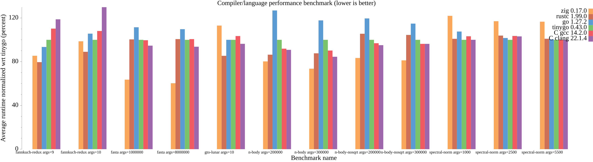

# tinybench

Benchmarks for comparing TinyGo performance.

## Benchmarks chosen and focus

- `gto-lunar`: Real-world GTO-to-lunar spacecraft trajectory calculation based on [Juan Pablo Sellanes' work](https://eventos.iua.edu.ar/event/1/contributions/51/).
- `fannkuch-redux`: Focused on integer operations on short arrays
- `fasta`: Generate and write random DNA sequences. This benchmark makes some use of dynamic memory allocation, thus putting Go's GC to test as well as Zig's allocator.
- `n-body`: Floating point operations and usage of math library (sqrt)
- `n-body-nosqrt`: Identical to above but replaces call to square-root math library function with an iterative solution. This benchmark shows the difference between C and Go math standard libraries. Go math library has more overhead for assembly implemented functions.
- `spectral-norm`: Eigenvalue using the power method. This benchmark makes extensive use of dynamic memory allocation.



## Benchmark code design
Benchmarks are designed "fairly" and with a focus on runtime performance. In the context of tinybench this means maintaining code equivalence between languages:

- Maintaining equivalence in data structures
- Maintaining equivalence in function signatures, their statements and ordering

We avoid:

- Explicitly moving code to compile-time when we can't do the same in other languages i.e Zig's comptime and C macros
- Compile flags which compromise program correctness like gcc/clang's `O3` and Zig's `ReleaseFast`

We allow:

- Data structure massaging. C and Zig allow bitpacking which is a commonly used feature in the languages and affects runtime performance, thus should be interesting to allow use.

## Compilers

- [clang](https://clang.llvm.org/)
- [gcc](https://gcc.gnu.org/)
- [TinyGo](https://tinygo.org/getting-started/). Either [quick install](https://tinygo.org/getting-started/install/) or [build from source](https://tinygo.org/docs/guides/build/)
- [Go](https://go.dev/)
- [Rust](https://www.rust-lang.org/)
- [Zig](https://ziglang.org/)


## Run Benchmarks

```sh
go test -v -bench=.

# Or to only run a certain test's benchmarks use expression "BenchmarkAll/<NAME OF TEST>:" 
go test -v -bench "BenchmarkAll/n-body:"  # You may need to escape the colon on windows powershell.
```

#### Generate benchmark image

Note the below command will not output results
```sh
go test -v -bench . | go run ./plot_/ -o benchmark.png
```


#### Output for 13th Gen Intel(R) Core(TM) i9-13900HX

<details>
<summary>Click to display</summary>

```
goos: linux
goarch: amd64
pkg: tinybench
cpu: 13th Gen Intel(R) Core(TM) i9-13900HX
BenchmarkAll
    bench_test.go:107: found compiler zig 0.17.0
    bench_test.go:107: found compiler rustc 1.99.0
    bench_test.go:107: found compiler go 1.27.2
    bench_test.go:107: found compiler tinygo 0.43.0
    bench_test.go:107: found compiler gcc 14.2.0
    bench_test.go:107: found compiler clang 22.1.4
    bench_test.go:109: looking for benchmarks in [fannkuch-redux fasta gto-lunar n-body n-body-nosqrt spectral-norm]
BenchmarkAll/fannkuch-redux:args=9/zig/zig
    bench_test.go:145: name="fannkuch-redux" compiler="zig" binarysize=4037336 version=0.17.0
BenchmarkAll/fannkuch-redux:args=9/zig/zig-32         	      69	  17168165 ns/op
BenchmarkAll/fannkuch-redux:args=10/zig/zig
BenchmarkAll/fannkuch-redux:args=10/zig/zig-32        	       7	 162937008 ns/op
BenchmarkAll/fannkuch-redux:args=9/rust/rustc
    bench_test.go:145: name="fannkuch-redux" compiler="rustc" binarysize=4545368 version=1.99.0
BenchmarkAll/fannkuch-redux:args=9/rust/rustc-32      	      75	  15996087 ns/op
BenchmarkAll/fannkuch-redux:args=10/rust/rustc
BenchmarkAll/fannkuch-redux:args=10/rust/rustc-32     	       7	 147067831 ns/op
BenchmarkAll/fannkuch-redux:args=9/go/go
    bench_test.go:145: name="fannkuch-redux" compiler="go" binarysize=2372002 version=1.27.2
BenchmarkAll/fannkuch-redux:args=9/go/go-32           	      61	  18783487 ns/op
BenchmarkAll/fannkuch-redux:args=10/go/go
BenchmarkAll/fannkuch-redux:args=10/go/go-32          	       6	 174458384 ns/op
BenchmarkAll/fannkuch-redux:args=9/go/tinygo
    bench_test.go:145: name="fannkuch-redux" compiler="tinygo" binarysize=1615592 version=0.43.0
BenchmarkAll/fannkuch-redux:args=9/go/tinygo-32       	      67	  20098803 ns/op
BenchmarkAll/fannkuch-redux:args=10/go/tinygo
BenchmarkAll/fannkuch-redux:args=10/go/tinygo-32      	       7	 165156635 ns/op
BenchmarkAll/fannkuch-redux:args=9/c/gcc
    bench_test.go:145: name="fannkuch-redux" compiler="gcc" binarysize=16416 version=14.2.0
BenchmarkAll/fannkuch-redux:args=9/c/gcc-32           	      57	  22160033 ns/op
BenchmarkAll/fannkuch-redux:args=10/c/gcc
BenchmarkAll/fannkuch-redux:args=10/c/gcc-32          	       6	 178495888 ns/op
BenchmarkAll/fannkuch-redux:args=9/c/clang
    bench_test.go:145: name="fannkuch-redux" compiler="clang" binarysize=16368 version=22.1.4
BenchmarkAll/fannkuch-redux:args=9/c/clang-32         	      55	  23863549 ns/op
BenchmarkAll/fannkuch-redux:args=10/c/clang
BenchmarkAll/fannkuch-redux:args=10/c/clang-32        	       5	 214441140 ns/op
BenchmarkAll/fasta:args=1000000/zig/zig
    bench_test.go:145: name="fasta" compiler="zig" binarysize=4043832 version=0.17.0
BenchmarkAll/fasta:args=1000000/zig/zig-32            	      16	  71318853 ns/op
BenchmarkAll/fasta:args=8000000/zig/zig
BenchmarkAll/fasta:args=8000000/zig/zig-32            	       2	 525875626 ns/op
BenchmarkAll/fasta:args=1000000/rust/rustc
    bench_test.go:145: name="fasta" compiler="rustc" binarysize=4545904 version=1.99.0
BenchmarkAll/fasta:args=1000000/rust/rustc-32         	       9	 112600740 ns/op
BenchmarkAll/fasta:args=8000000/rust/rustc
BenchmarkAll/fasta:args=8000000/rust/rustc-32         	       2	 877185292 ns/op
BenchmarkAll/fasta:args=1000000/go/go
    bench_test.go:145: name="fasta" compiler="go" binarysize=2482193 version=1.27.2
BenchmarkAll/fasta:args=1000000/go/go-32              	       9	 125028606 ns/op
BenchmarkAll/fasta:args=8000000/go/go
BenchmarkAll/fasta:args=8000000/go/go-32              	       2	 956324623 ns/op
BenchmarkAll/fasta:args=1000000/go/tinygo
    bench_test.go:145: name="fasta" compiler="tinygo" binarysize=1769384 version=0.43.0
BenchmarkAll/fasta:args=1000000/go/tinygo-32          	       9	 112162579 ns/op
BenchmarkAll/fasta:args=8000000/go/tinygo
BenchmarkAll/fasta:args=8000000/go/tinygo-32          	       2	 871533490 ns/op
BenchmarkAll/fasta:args=1000000/c/gcc
    bench_test.go:145: name="fasta" compiler="gcc" binarysize=16352 version=14.2.0
BenchmarkAll/fasta:args=1000000/c/gcc-32              	       9	 111731068 ns/op
BenchmarkAll/fasta:args=8000000/c/gcc
BenchmarkAll/fasta:args=8000000/c/gcc-32              	       2	 877102112 ns/op
BenchmarkAll/fasta:args=1000000/c/clang
    bench_test.go:145: name="fasta" compiler="clang" binarysize=16280 version=22.1.4
BenchmarkAll/fasta:args=1000000/c/clang-32            	      10	 106165806 ns/op
BenchmarkAll/fasta:args=8000000/c/clang
BenchmarkAll/fasta:args=8000000/c/clang-32            	       2	 816502502 ns/op
BenchmarkAll/gto-lunar:args=10/zig/zig
    bench_test.go:145: name="gto-lunar" compiler="zig" binarysize=4218064 version=0.17.0
BenchmarkAll/gto-lunar:args=10/zig/zig-32             	       2	 675574549 ns/op
BenchmarkAll/gto-lunar:args=10/rust/rustc
    bench_test.go:145: name="gto-lunar" compiler="rustc" binarysize=4602408 version=1.99.0
BenchmarkAll/gto-lunar:args=10/rust/rustc-32          	       2	 510236074 ns/op
BenchmarkAll/gto-lunar:args=10/go/go
    bench_test.go:145: name="gto-lunar" compiler="go" binarysize=2446957 version=1.27.2
BenchmarkAll/gto-lunar:args=10/go/go-32               	       2	 597636114 ns/op
BenchmarkAll/gto-lunar:args=10/go/tinygo
    bench_test.go:145: name="gto-lunar" compiler="tinygo" binarysize=1704368 version=0.43.0
BenchmarkAll/gto-lunar:args=10/go/tinygo-32           	       2	 597674280 ns/op
BenchmarkAll/gto-lunar:args=10/c/gcc
    bench_test.go:145: name="gto-lunar" compiler="gcc" binarysize=25024 version=14.2.0
BenchmarkAll/gto-lunar:args=10/c/gcc-32               	       2	 618216562 ns/op
BenchmarkAll/gto-lunar:args=10/c/clang
    bench_test.go:145: name="gto-lunar" compiler="clang" binarysize=20768 version=22.1.4
BenchmarkAll/gto-lunar:args=10/c/clang-32             	       2	 575748040 ns/op
BenchmarkAll/n-body:args=200000/zig/zig
    bench_test.go:145: name="n-body" compiler="zig" binarysize=4075200 version=0.17.0
BenchmarkAll/n-body:args=200000/zig/zig-32            	      81	  13637664 ns/op
BenchmarkAll/n-body:args=300000/zig/zig
BenchmarkAll/n-body:args=300000/zig/zig-32            	      69	  17113490 ns/op
BenchmarkAll/n-body:args=200000/rust/rustc
    bench_test.go:145: name="n-body" compiler="rustc" binarysize=4575320 version=1.99.0
BenchmarkAll/n-body:args=200000/rust/rustc-32         	      74	  14679155 ns/op
BenchmarkAll/n-body:args=300000/rust/rustc
BenchmarkAll/n-body:args=300000/rust/rustc-32         	      61	  20373343 ns/op
BenchmarkAll/n-body:args=200000/go/go
    bench_test.go:145: name="n-body" compiler="go" binarysize=2372796 version=1.27.2
BenchmarkAll/n-body:args=200000/go/go-32              	      50	  21550415 ns/op
BenchmarkAll/n-body:args=300000/go/go
BenchmarkAll/n-body:args=300000/go/go-32              	      38	  27375239 ns/op
BenchmarkAll/n-body:args=200000/go/tinygo
    bench_test.go:145: name="n-body" compiler="tinygo" binarysize=1622904 version=0.43.0
BenchmarkAll/n-body:args=200000/go/tinygo-32          	      68	  16991503 ns/op
BenchmarkAll/n-body:args=300000/go/tinygo
BenchmarkAll/n-body:args=300000/go/tinygo-32          	      60	  23246272 ns/op
BenchmarkAll/n-body:args=200000/c/gcc
    bench_test.go:145: name="n-body" compiler="gcc" binarysize=16576 version=14.2.0
BenchmarkAll/n-body:args=200000/c/gcc-32              	     100	  15615891 ns/op
BenchmarkAll/n-body:args=300000/c/gcc
BenchmarkAll/n-body:args=300000/c/gcc-32              	      56	  20968130 ns/op
BenchmarkAll/n-body:args=200000/c/clang
    bench_test.go:145: name="n-body" compiler="clang" binarysize=16544 version=22.1.4
BenchmarkAll/n-body:args=200000/c/clang-32            	      91	  15431208 ns/op
BenchmarkAll/n-body:args=300000/c/clang
BenchmarkAll/n-body:args=300000/c/clang-32            	      64	  19643684 ns/op
BenchmarkAll/n-body-nosqrt:args=200000/zig/zig
    bench_test.go:145: name="n-body-nosqrt" compiler="zig" binarysize=4080512 version=0.17.0
BenchmarkAll/n-body-nosqrt:args=200000/zig/zig-32     	      25	  46828731 ns/op
BenchmarkAll/n-body-nosqrt:args=300000/zig/zig
BenchmarkAll/n-body-nosqrt:args=300000/zig/zig-32     	      15	  67110198 ns/op
BenchmarkAll/n-body-nosqrt:args=200000/rust/rustc
    bench_test.go:145: name="n-body-nosqrt" compiler="rustc" binarysize=4572344 version=1.99.0
BenchmarkAll/n-body-nosqrt:args=200000/rust/rustc-32  	      18	  59257064 ns/op
BenchmarkAll/n-body-nosqrt:args=300000/rust/rustc
BenchmarkAll/n-body-nosqrt:args=300000/rust/rustc-32  	      13	  86336180 ns/op
BenchmarkAll/n-body-nosqrt:args=200000/go/go
    bench_test.go:145: name="n-body-nosqrt" compiler="go" binarysize=2373272 version=1.27.2
BenchmarkAll/n-body-nosqrt:args=200000/go/go-32       	      16	  67120110 ns/op
BenchmarkAll/n-body-nosqrt:args=300000/go/go
BenchmarkAll/n-body-nosqrt:args=300000/go/go-32       	      12	  94877662 ns/op
BenchmarkAll/n-body-nosqrt:args=200000/go/tinygo
    bench_test.go:145: name="n-body-nosqrt" compiler="tinygo" binarysize=1623928 version=0.43.0
BenchmarkAll/n-body-nosqrt:args=200000/go/tinygo-32   	      21	  56145941 ns/op
BenchmarkAll/n-body-nosqrt:args=300000/go/tinygo
BenchmarkAll/n-body-nosqrt:args=300000/go/tinygo-32   	      14	  82643963 ns/op
BenchmarkAll/n-body-nosqrt:args=200000/c/gcc
    bench_test.go:145: name="n-body-nosqrt" compiler="gcc" binarysize=16656 version=14.2.0
BenchmarkAll/n-body-nosqrt:args=200000/c/gcc-32       	      19	  54394363 ns/op
BenchmarkAll/n-body-nosqrt:args=300000/c/gcc
BenchmarkAll/n-body-nosqrt:args=300000/c/gcc-32       	      14	  79589994 ns/op
BenchmarkAll/n-body-nosqrt:args=200000/c/clang
    bench_test.go:145: name="n-body-nosqrt" compiler="clang" binarysize=16624 version=22.1.4
BenchmarkAll/n-body-nosqrt:args=200000/c/clang-32     	      19	  53393879 ns/op
BenchmarkAll/n-body-nosqrt:args=300000/c/clang
BenchmarkAll/n-body-nosqrt:args=300000/c/clang-32     	      15	  79579006 ns/op
BenchmarkAll/spectral-norm:args=1000/zig/zig
    bench_test.go:145: name="spectral-norm" compiler="zig" binarysize=4077312 version=0.17.0
BenchmarkAll/spectral-norm:args=1000/zig/zig-32       	      20	  58235256 ns/op
BenchmarkAll/spectral-norm:args=2500/zig/zig
BenchmarkAll/spectral-norm:args=2500/zig/zig-32       	       4	 311430268 ns/op
BenchmarkAll/spectral-norm:args=5500/zig/zig
BenchmarkAll/spectral-norm:args=5500/zig/zig-32       	       1	1501666148 ns/op
BenchmarkAll/spectral-norm:args=1000/rust/rustc
    bench_test.go:145: name="spectral-norm" compiler="rustc" binarysize=4568080 version=1.99.0
BenchmarkAll/spectral-norm:args=1000/rust/rustc-32    	      25	  48202033 ns/op
BenchmarkAll/spectral-norm:args=2500/rust/rustc
BenchmarkAll/spectral-norm:args=2500/rust/rustc-32    	       4	 276424656 ns/op
BenchmarkAll/spectral-norm:args=5500/rust/rustc
BenchmarkAll/spectral-norm:args=5500/rust/rustc-32    	       1	1300507796 ns/op
BenchmarkAll/spectral-norm:args=1000/go/go
    bench_test.go:145: name="spectral-norm" compiler="go" binarysize=2470237 version=1.27.2
BenchmarkAll/spectral-norm:args=1000/go/go-32         	      25	  51377288 ns/op
BenchmarkAll/spectral-norm:args=2500/go/go
BenchmarkAll/spectral-norm:args=2500/go/go-32         	       4	 270529693 ns/op
BenchmarkAll/spectral-norm:args=5500/go/go
BenchmarkAll/spectral-norm:args=5500/go/go-32         	       1	1293590627 ns/op
BenchmarkAll/spectral-norm:args=1000/go/tinygo
    bench_test.go:145: name="spectral-norm" compiler="tinygo" binarysize=1744584 version=0.43.0
BenchmarkAll/spectral-norm:args=1000/go/tinygo-32     	      24	  47761924 ns/op
BenchmarkAll/spectral-norm:args=2500/go/tinygo
BenchmarkAll/spectral-norm:args=2500/go/tinygo-32     	       4	 266115472 ns/op
BenchmarkAll/spectral-norm:args=5500/go/tinygo
BenchmarkAll/spectral-norm:args=5500/go/tinygo-32     	       1	1288013821 ns/op
BenchmarkAll/spectral-norm:args=1000/c/gcc
    bench_test.go:145: name="spectral-norm" compiler="gcc" binarysize=16240 version=14.2.0
BenchmarkAll/spectral-norm:args=1000/c/gcc-32         	      25	  49308729 ns/op
BenchmarkAll/spectral-norm:args=2500/c/gcc
BenchmarkAll/spectral-norm:args=2500/c/gcc-32         	       4	 275487228 ns/op
BenchmarkAll/spectral-norm:args=5500/c/gcc
BenchmarkAll/spectral-norm:args=5500/c/gcc-32         	       1	1288121053 ns/op
BenchmarkAll/spectral-norm:args=1000/c/clang
    bench_test.go:145: name="spectral-norm" compiler="clang" binarysize=16224 version=22.1.4
BenchmarkAll/spectral-norm:args=1000/c/clang-32       	      22	  47765474 ns/op
BenchmarkAll/spectral-norm:args=2500/c/clang
BenchmarkAll/spectral-norm:args=2500/c/clang-32       	       4	 274424259 ns/op
BenchmarkAll/spectral-norm:args=5500/c/clang
BenchmarkAll/spectral-norm:args=5500/c/clang-32       	       1	1287113987 ns/op
PASS
ok  	tinybench	211.432s
```

</details>

## Result Summary

- TinyGo is notably faster at integer number crunching.
- TinyGo and C go head-to-head on floating point math when not calling specialized functions such as `sqrt`. Go lags behind.

## Add a benchmark

The way tinybench works is all directories with no `.` or `_` character (anywhere in name) in this repo's root directory are added to the benchmark corpus.
Within each of these directories a `c` and `go` folder is searched for and their code compiled and run automatically. Flags used for the compilers can be found in [`compilerflags_test.go`](./compilerflags_test.go).

To add a new test follow these steps:

1. Creating a new top level folder with a descriptive name such as `mandelbrot` with no `.` or `_` characters

2. Add an `args.txt` file to the folder with the OS arguments to the program and add a single line with an argument i.e: `-s 1024` (flag `s` with value `1024`).
    - Each line of this file will contain a benchmark case.

3. Create folders with the language you wish to test. Each will be run with arguments provided by `args.txt`. Each folder should contain a single file called `main.<extension>` where `<extension>` is the file extension of the language being tested.
    - `<benchmark-name>/c/main.c`: Contains the C source code for benchmark. Since linking is done via flags you must add your project's flags to `gccFlags` map.
    - `<benchmark-name>/go/main.go`: Will contain a `package main` project that is compiled for the benchmark.
    - `<benchmark-name>/rust/main.rs`: Contains the Rust source code for benchmark.
    - `<benchmark-name>/zig/main.zig`: Contains the Zig source code for benchmark.
