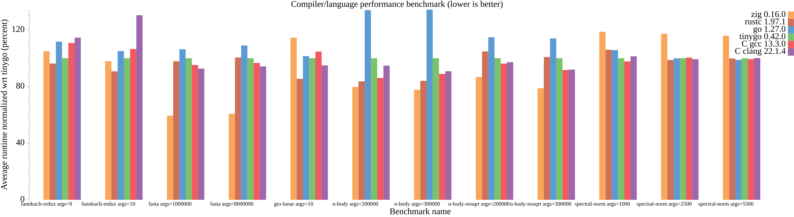
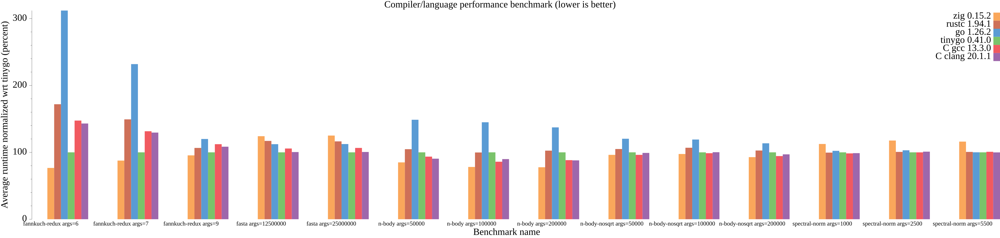
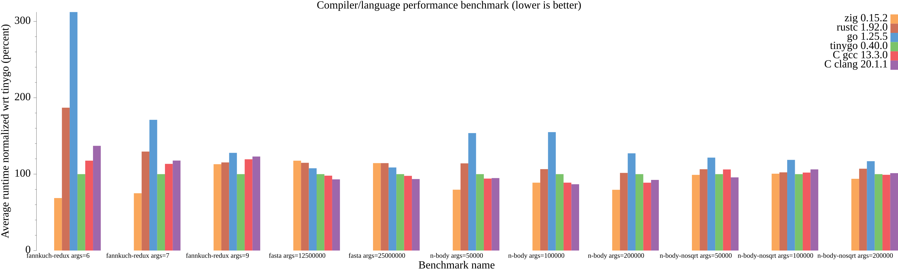
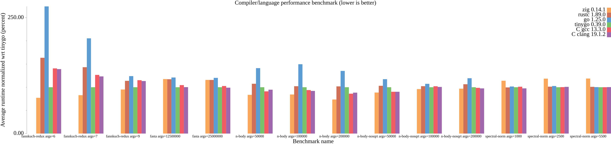

# Results

## TinyGo 0.43.0


### Output for 13th Gen Intel(R) Core(TM) i9-13900HX

<details>
<summary>Click to display</summary>

```
goos: linux
goarch: amd64
pkg: tinybench
cpu: 13th Gen Intel(R) Core(TM) i9-13900HX
BenchmarkAll
    bench_test.go:107: found compiler zig 0.17.0
    bench_test.go:107: found compiler rustc 1.99.0
    bench_test.go:107: found compiler go 1.27.2
    bench_test.go:107: found compiler tinygo 0.43.0
    bench_test.go:107: found compiler gcc 14.2.0
    bench_test.go:107: found compiler clang 22.1.4
    bench_test.go:109: looking for benchmarks in [fannkuch-redux fasta gto-lunar n-body n-body-nosqrt spectral-norm]
BenchmarkAll/fannkuch-redux:args=9/zig/zig
    bench_test.go:145: name="fannkuch-redux" compiler="zig" binarysize=4037336 version=0.17.0
BenchmarkAll/fannkuch-redux:args=9/zig/zig-32         	      69	  17168165 ns/op
BenchmarkAll/fannkuch-redux:args=10/zig/zig
BenchmarkAll/fannkuch-redux:args=10/zig/zig-32        	       7	 162937008 ns/op
BenchmarkAll/fannkuch-redux:args=9/rust/rustc
    bench_test.go:145: name="fannkuch-redux" compiler="rustc" binarysize=4545368 version=1.99.0
BenchmarkAll/fannkuch-redux:args=9/rust/rustc-32      	      75	  15996087 ns/op
BenchmarkAll/fannkuch-redux:args=10/rust/rustc
BenchmarkAll/fannkuch-redux:args=10/rust/rustc-32     	       7	 147067831 ns/op
BenchmarkAll/fannkuch-redux:args=9/go/go
    bench_test.go:145: name="fannkuch-redux" compiler="go" binarysize=2372002 version=1.27.2
BenchmarkAll/fannkuch-redux:args=9/go/go-32           	      61	  18783487 ns/op
BenchmarkAll/fannkuch-redux:args=10/go/go
BenchmarkAll/fannkuch-redux:args=10/go/go-32          	       6	 174458384 ns/op
BenchmarkAll/fannkuch-redux:args=9/go/tinygo
    bench_test.go:145: name="fannkuch-redux" compiler="tinygo" binarysize=1615592 version=0.43.0
BenchmarkAll/fannkuch-redux:args=9/go/tinygo-32       	      67	  20098803 ns/op
BenchmarkAll/fannkuch-redux:args=10/go/tinygo
BenchmarkAll/fannkuch-redux:args=10/go/tinygo-32      	       7	 165156635 ns/op
BenchmarkAll/fannkuch-redux:args=9/c/gcc
    bench_test.go:145: name="fannkuch-redux" compiler="gcc" binarysize=16416 version=14.2.0
BenchmarkAll/fannkuch-redux:args=9/c/gcc-32           	      57	  22160033 ns/op
BenchmarkAll/fannkuch-redux:args=10/c/gcc
BenchmarkAll/fannkuch-redux:args=10/c/gcc-32          	       6	 178495888 ns/op
BenchmarkAll/fannkuch-redux:args=9/c/clang
    bench_test.go:145: name="fannkuch-redux" compiler="clang" binarysize=16368 version=22.1.4
BenchmarkAll/fannkuch-redux:args=9/c/clang-32         	      55	  23863549 ns/op
BenchmarkAll/fannkuch-redux:args=10/c/clang
BenchmarkAll/fannkuch-redux:args=10/c/clang-32        	       5	 214441140 ns/op
BenchmarkAll/fasta:args=1000000/zig/zig
    bench_test.go:145: name="fasta" compiler="zig" binarysize=4043832 version=0.17.0
BenchmarkAll/fasta:args=1000000/zig/zig-32            	      16	  71318853 ns/op
BenchmarkAll/fasta:args=8000000/zig/zig
BenchmarkAll/fasta:args=8000000/zig/zig-32            	       2	 525875626 ns/op
BenchmarkAll/fasta:args=1000000/rust/rustc
    bench_test.go:145: name="fasta" compiler="rustc" binarysize=4545904 version=1.99.0
BenchmarkAll/fasta:args=1000000/rust/rustc-32         	       9	 112600740 ns/op
BenchmarkAll/fasta:args=8000000/rust/rustc
BenchmarkAll/fasta:args=8000000/rust/rustc-32         	       2	 877185292 ns/op
BenchmarkAll/fasta:args=1000000/go/go
    bench_test.go:145: name="fasta" compiler="go" binarysize=2482193 version=1.27.2
BenchmarkAll/fasta:args=1000000/go/go-32              	       9	 125028606 ns/op
BenchmarkAll/fasta:args=8000000/go/go
BenchmarkAll/fasta:args=8000000/go/go-32              	       2	 956324623 ns/op
BenchmarkAll/fasta:args=1000000/go/tinygo
    bench_test.go:145: name="fasta" compiler="tinygo" binarysize=1769384 version=0.43.0
BenchmarkAll/fasta:args=1000000/go/tinygo-32          	       9	 112162579 ns/op
BenchmarkAll/fasta:args=8000000/go/tinygo
BenchmarkAll/fasta:args=8000000/go/tinygo-32          	       2	 871533490 ns/op
BenchmarkAll/fasta:args=1000000/c/gcc
    bench_test.go:145: name="fasta" compiler="gcc" binarysize=16352 version=14.2.0
BenchmarkAll/fasta:args=1000000/c/gcc-32              	       9	 111731068 ns/op
BenchmarkAll/fasta:args=8000000/c/gcc
BenchmarkAll/fasta:args=8000000/c/gcc-32              	       2	 877102112 ns/op
BenchmarkAll/fasta:args=1000000/c/clang
    bench_test.go:145: name="fasta" compiler="clang" binarysize=16280 version=22.1.4
BenchmarkAll/fasta:args=1000000/c/clang-32            	      10	 106165806 ns/op
BenchmarkAll/fasta:args=8000000/c/clang
BenchmarkAll/fasta:args=8000000/c/clang-32            	       2	 816502502 ns/op
BenchmarkAll/gto-lunar:args=10/zig/zig
    bench_test.go:145: name="gto-lunar" compiler="zig" binarysize=4218064 version=0.17.0
BenchmarkAll/gto-lunar:args=10/zig/zig-32             	       2	 675574549 ns/op
BenchmarkAll/gto-lunar:args=10/rust/rustc
    bench_test.go:145: name="gto-lunar" compiler="rustc" binarysize=4602408 version=1.99.0
BenchmarkAll/gto-lunar:args=10/rust/rustc-32          	       2	 510236074 ns/op
BenchmarkAll/gto-lunar:args=10/go/go
    bench_test.go:145: name="gto-lunar" compiler="go" binarysize=2446957 version=1.27.2
BenchmarkAll/gto-lunar:args=10/go/go-32               	       2	 597636114 ns/op
BenchmarkAll/gto-lunar:args=10/go/tinygo
    bench_test.go:145: name="gto-lunar" compiler="tinygo" binarysize=1704368 version=0.43.0
BenchmarkAll/gto-lunar:args=10/go/tinygo-32           	       2	 597674280 ns/op
BenchmarkAll/gto-lunar:args=10/c/gcc
    bench_test.go:145: name="gto-lunar" compiler="gcc" binarysize=25024 version=14.2.0
BenchmarkAll/gto-lunar:args=10/c/gcc-32               	       2	 618216562 ns/op
BenchmarkAll/gto-lunar:args=10/c/clang
    bench_test.go:145: name="gto-lunar" compiler="clang" binarysize=20768 version=22.1.4
BenchmarkAll/gto-lunar:args=10/c/clang-32             	       2	 575748040 ns/op
BenchmarkAll/n-body:args=200000/zig/zig
    bench_test.go:145: name="n-body" compiler="zig" binarysize=4075200 version=0.17.0
BenchmarkAll/n-body:args=200000/zig/zig-32            	      81	  13637664 ns/op
BenchmarkAll/n-body:args=300000/zig/zig
BenchmarkAll/n-body:args=300000/zig/zig-32            	      69	  17113490 ns/op
BenchmarkAll/n-body:args=200000/rust/rustc
    bench_test.go:145: name="n-body" compiler="rustc" binarysize=4575320 version=1.99.0
BenchmarkAll/n-body:args=200000/rust/rustc-32         	      74	  14679155 ns/op
BenchmarkAll/n-body:args=300000/rust/rustc
BenchmarkAll/n-body:args=300000/rust/rustc-32         	      61	  20373343 ns/op
BenchmarkAll/n-body:args=200000/go/go
    bench_test.go:145: name="n-body" compiler="go" binarysize=2372796 version=1.27.2
BenchmarkAll/n-body:args=200000/go/go-32              	      50	  21550415 ns/op
BenchmarkAll/n-body:args=300000/go/go
BenchmarkAll/n-body:args=300000/go/go-32              	      38	  27375239 ns/op
BenchmarkAll/n-body:args=200000/go/tinygo
    bench_test.go:145: name="n-body" compiler="tinygo" binarysize=1622904 version=0.43.0
BenchmarkAll/n-body:args=200000/go/tinygo-32          	      68	  16991503 ns/op
BenchmarkAll/n-body:args=300000/go/tinygo
BenchmarkAll/n-body:args=300000/go/tinygo-32          	      60	  23246272 ns/op
BenchmarkAll/n-body:args=200000/c/gcc
    bench_test.go:145: name="n-body" compiler="gcc" binarysize=16576 version=14.2.0
BenchmarkAll/n-body:args=200000/c/gcc-32              	     100	  15615891 ns/op
BenchmarkAll/n-body:args=300000/c/gcc
BenchmarkAll/n-body:args=300000/c/gcc-32              	      56	  20968130 ns/op
BenchmarkAll/n-body:args=200000/c/clang
    bench_test.go:145: name="n-body" compiler="clang" binarysize=16544 version=22.1.4
BenchmarkAll/n-body:args=200000/c/clang-32            	      91	  15431208 ns/op
BenchmarkAll/n-body:args=300000/c/clang
BenchmarkAll/n-body:args=300000/c/clang-32            	      64	  19643684 ns/op
BenchmarkAll/n-body-nosqrt:args=200000/zig/zig
    bench_test.go:145: name="n-body-nosqrt" compiler="zig" binarysize=4080512 version=0.17.0
BenchmarkAll/n-body-nosqrt:args=200000/zig/zig-32     	      25	  46828731 ns/op
BenchmarkAll/n-body-nosqrt:args=300000/zig/zig
BenchmarkAll/n-body-nosqrt:args=300000/zig/zig-32     	      15	  67110198 ns/op
BenchmarkAll/n-body-nosqrt:args=200000/rust/rustc
    bench_test.go:145: name="n-body-nosqrt" compiler="rustc" binarysize=4572344 version=1.99.0
BenchmarkAll/n-body-nosqrt:args=200000/rust/rustc-32  	      18	  59257064 ns/op
BenchmarkAll/n-body-nosqrt:args=300000/rust/rustc
BenchmarkAll/n-body-nosqrt:args=300000/rust/rustc-32  	      13	  86336180 ns/op
BenchmarkAll/n-body-nosqrt:args=200000/go/go
    bench_test.go:145: name="n-body-nosqrt" compiler="go" binarysize=2373272 version=1.27.2
BenchmarkAll/n-body-nosqrt:args=200000/go/go-32       	      16	  67120110 ns/op
BenchmarkAll/n-body-nosqrt:args=300000/go/go
BenchmarkAll/n-body-nosqrt:args=300000/go/go-32       	      12	  94877662 ns/op
BenchmarkAll/n-body-nosqrt:args=200000/go/tinygo
    bench_test.go:145: name="n-body-nosqrt" compiler="tinygo" binarysize=1623928 version=0.43.0
BenchmarkAll/n-body-nosqrt:args=200000/go/tinygo-32   	      21	  56145941 ns/op
BenchmarkAll/n-body-nosqrt:args=300000/go/tinygo
BenchmarkAll/n-body-nosqrt:args=300000/go/tinygo-32   	      14	  82643963 ns/op
BenchmarkAll/n-body-nosqrt:args=200000/c/gcc
    bench_test.go:145: name="n-body-nosqrt" compiler="gcc" binarysize=16656 version=14.2.0
BenchmarkAll/n-body-nosqrt:args=200000/c/gcc-32       	      19	  54394363 ns/op
BenchmarkAll/n-body-nosqrt:args=300000/c/gcc
BenchmarkAll/n-body-nosqrt:args=300000/c/gcc-32       	      14	  79589994 ns/op
BenchmarkAll/n-body-nosqrt:args=200000/c/clang
    bench_test.go:145: name="n-body-nosqrt" compiler="clang" binarysize=16624 version=22.1.4
BenchmarkAll/n-body-nosqrt:args=200000/c/clang-32     	      19	  53393879 ns/op
BenchmarkAll/n-body-nosqrt:args=300000/c/clang
BenchmarkAll/n-body-nosqrt:args=300000/c/clang-32     	      15	  79579006 ns/op
BenchmarkAll/spectral-norm:args=1000/zig/zig
    bench_test.go:145: name="spectral-norm" compiler="zig" binarysize=4077312 version=0.17.0
BenchmarkAll/spectral-norm:args=1000/zig/zig-32       	      20	  58235256 ns/op
BenchmarkAll/spectral-norm:args=2500/zig/zig
BenchmarkAll/spectral-norm:args=2500/zig/zig-32       	       4	 311430268 ns/op
BenchmarkAll/spectral-norm:args=5500/zig/zig
BenchmarkAll/spectral-norm:args=5500/zig/zig-32       	       1	1501666148 ns/op
BenchmarkAll/spectral-norm:args=1000/rust/rustc
    bench_test.go:145: name="spectral-norm" compiler="rustc" binarysize=4568080 version=1.99.0
BenchmarkAll/spectral-norm:args=1000/rust/rustc-32    	      25	  48202033 ns/op
BenchmarkAll/spectral-norm:args=2500/rust/rustc
BenchmarkAll/spectral-norm:args=2500/rust/rustc-32    	       4	 276424656 ns/op
BenchmarkAll/spectral-norm:args=5500/rust/rustc
BenchmarkAll/spectral-norm:args=5500/rust/rustc-32    	       1	1300507796 ns/op
BenchmarkAll/spectral-norm:args=1000/go/go
    bench_test.go:145: name="spectral-norm" compiler="go" binarysize=2470237 version=1.27.2
BenchmarkAll/spectral-norm:args=1000/go/go-32         	      25	  51377288 ns/op
BenchmarkAll/spectral-norm:args=2500/go/go
BenchmarkAll/spectral-norm:args=2500/go/go-32         	       4	 270529693 ns/op
BenchmarkAll/spectral-norm:args=5500/go/go
BenchmarkAll/spectral-norm:args=5500/go/go-32         	       1	1293590627 ns/op
BenchmarkAll/spectral-norm:args=1000/go/tinygo
    bench_test.go:145: name="spectral-norm" compiler="tinygo" binarysize=1744584 version=0.43.0
BenchmarkAll/spectral-norm:args=1000/go/tinygo-32     	      24	  47761924 ns/op
BenchmarkAll/spectral-norm:args=2500/go/tinygo
BenchmarkAll/spectral-norm:args=2500/go/tinygo-32     	       4	 266115472 ns/op
BenchmarkAll/spectral-norm:args=5500/go/tinygo
BenchmarkAll/spectral-norm:args=5500/go/tinygo-32     	       1	1288013821 ns/op
BenchmarkAll/spectral-norm:args=1000/c/gcc
    bench_test.go:145: name="spectral-norm" compiler="gcc" binarysize=16240 version=14.2.0
BenchmarkAll/spectral-norm:args=1000/c/gcc-32         	      25	  49308729 ns/op
BenchmarkAll/spectral-norm:args=2500/c/gcc
BenchmarkAll/spectral-norm:args=2500/c/gcc-32         	       4	 275487228 ns/op
BenchmarkAll/spectral-norm:args=5500/c/gcc
BenchmarkAll/spectral-norm:args=5500/c/gcc-32         	       1	1288121053 ns/op
BenchmarkAll/spectral-norm:args=1000/c/clang
    bench_test.go:145: name="spectral-norm" compiler="clang" binarysize=16224 version=22.1.4
BenchmarkAll/spectral-norm:args=1000/c/clang-32       	      22	  47765474 ns/op
BenchmarkAll/spectral-norm:args=2500/c/clang
BenchmarkAll/spectral-norm:args=2500/c/clang-32       	       4	 274424259 ns/op
BenchmarkAll/spectral-norm:args=5500/c/clang
BenchmarkAll/spectral-norm:args=5500/c/clang-32       	       1	1287113987 ns/op
PASS
ok  	tinybench	211.432s
```

</details>

## TinyGo 0.42.0



### Output for 13th Gen Intel(R) Core(TM) i9-13900HX

<details>
<summary>Click to display</summary>

```
goos: linux
goarch: amd64
pkg: tinybench
cpu: 13th Gen Intel(R) Core(TM) i9-13900HX
BenchmarkAll
    bench_test.go:107: found compiler zig 0.16.0
    bench_test.go:107: found compiler rustc 1.97.1
    bench_test.go:107: found compiler go 1.27.0
    bench_test.go:107: found compiler tinygo 0.42.0
    bench_test.go:107: found compiler gcc 13.3.0
    bench_test.go:107: found compiler clang 22.1.4
    bench_test.go:109: looking for benchmarks in [fannkuch-redux fasta gto-lunar n-body n-body-nosqrt spectral-norm]
BenchmarkAll/fannkuch-redux:args=9/zig/zig
    bench_test.go:145: name="fannkuch-redux" compiler="zig" binarysize=3745392 version=0.16.0
BenchmarkAll/fannkuch-redux:args=9/zig/zig-32         	      64	  20230117 ns/op
BenchmarkAll/fannkuch-redux:args=10/zig/zig
BenchmarkAll/fannkuch-redux:args=10/zig/zig-32        	       6	 178051773 ns/op
BenchmarkAll/fannkuch-redux:args=9/rust/rustc
    bench_test.go:145: name="fannkuch-redux" compiler="rustc" binarysize=4363080 version=1.97.1
BenchmarkAll/fannkuch-redux:args=9/rust/rustc-32      	      57	  19782881 ns/op
BenchmarkAll/fannkuch-redux:args=10/rust/rustc
BenchmarkAll/fannkuch-redux:args=10/rust/rustc-32     	       7	 149555168 ns/op
BenchmarkAll/fannkuch-redux:args=9/go/go
    bench_test.go:145: name="fannkuch-redux" compiler="go" binarysize=2371570 version=1.27.0
BenchmarkAll/fannkuch-redux:args=9/go/go-32           	      51	  23233995 ns/op
BenchmarkAll/fannkuch-redux:args=10/go/go
BenchmarkAll/fannkuch-redux:args=10/go/go-32          	       6	 183068159 ns/op
BenchmarkAll/fannkuch-redux:args=9/go/tinygo
    bench_test.go:145: name="fannkuch-redux" compiler="tinygo" binarysize=1505384 version=0.42.0
BenchmarkAll/fannkuch-redux:args=9/go/tinygo-32       	      70	  21248849 ns/op
BenchmarkAll/fannkuch-redux:args=10/go/tinygo
BenchmarkAll/fannkuch-redux:args=10/go/tinygo-32      	       7	 168945704 ns/op
BenchmarkAll/fannkuch-redux:args=9/c/gcc
    bench_test.go:145: name="fannkuch-redux" compiler="gcc" binarysize=16416 version=13.3.0
BenchmarkAll/fannkuch-redux:args=9/c/gcc-32           	      55	  22572875 ns/op
BenchmarkAll/fannkuch-redux:args=10/c/gcc
BenchmarkAll/fannkuch-redux:args=10/c/gcc-32          	       6	 177954370 ns/op
BenchmarkAll/fannkuch-redux:args=9/c/clang
    bench_test.go:145: name="fannkuch-redux" compiler="clang" binarysize=16368 version=22.1.4
BenchmarkAll/fannkuch-redux:args=9/c/clang-32         	      52	  22887767 ns/op
BenchmarkAll/fannkuch-redux:args=10/c/clang
BenchmarkAll/fannkuch-redux:args=10/c/clang-32        	       5	 213103549 ns/op
BenchmarkAll/fasta:args=1000000/zig/zig
    bench_test.go:145: name="fasta" compiler="zig" binarysize=3750072 version=0.16.0
BenchmarkAll/fasta:args=1000000/zig/zig-32            	      14	  73586300 ns/op
BenchmarkAll/fasta:args=8000000/zig/zig
BenchmarkAll/fasta:args=8000000/zig/zig-32            	       2	 551959650 ns/op
BenchmarkAll/fasta:args=1000000/rust/rustc
    bench_test.go:145: name="fasta" compiler="rustc" binarysize=4364384 version=1.97.1
BenchmarkAll/fasta:args=1000000/rust/rustc-32         	       9	 115801101 ns/op
BenchmarkAll/fasta:args=8000000/rust/rustc
BenchmarkAll/fasta:args=8000000/rust/rustc-32         	       2	 917361790 ns/op
BenchmarkAll/fasta:args=1000000/go/go
    bench_test.go:145: name="fasta" compiler="go" binarysize=2481929 version=1.27.0
BenchmarkAll/fasta:args=1000000/go/go-32              	       9	 125239903 ns/op
BenchmarkAll/fasta:args=8000000/go/go
BenchmarkAll/fasta:args=8000000/go/go-32              	       2	 977977450 ns/op
BenchmarkAll/fasta:args=1000000/go/tinygo
    bench_test.go:145: name="fasta" compiler="tinygo" binarysize=1660728 version=0.42.0
BenchmarkAll/fasta:args=1000000/go/tinygo-32          	       9	 114194420 ns/op
BenchmarkAll/fasta:args=8000000/go/tinygo
BenchmarkAll/fasta:args=8000000/go/tinygo-32          	       2	 875018540 ns/op
BenchmarkAll/fasta:args=1000000/c/gcc
    bench_test.go:145: name="fasta" compiler="gcc" binarysize=16352 version=13.3.0
BenchmarkAll/fasta:args=1000000/c/gcc-32              	      10	 109309851 ns/op
BenchmarkAll/fasta:args=8000000/c/gcc
BenchmarkAll/fasta:args=8000000/c/gcc-32              	       2	 856265132 ns/op
BenchmarkAll/fasta:args=1000000/c/clang
    bench_test.go:145: name="fasta" compiler="clang" binarysize=16280 version=22.1.4
BenchmarkAll/fasta:args=1000000/c/clang-32            	      10	 107470143 ns/op
BenchmarkAll/fasta:args=8000000/c/clang
BenchmarkAll/fasta:args=8000000/c/clang-32            	       2	 822931552 ns/op
BenchmarkAll/gto-lunar:args=10/zig/zig
    bench_test.go:145: name="gto-lunar" compiler="zig" binarysize=3928288 version=0.16.0
BenchmarkAll/gto-lunar:args=10/zig/zig-32             	       2	 704901884 ns/op
BenchmarkAll/gto-lunar:args=10/rust/rustc
    bench_test.go:145: name="gto-lunar" compiler="rustc" binarysize=4419976 version=1.97.1
BenchmarkAll/gto-lunar:args=10/rust/rustc-32          	       2	 515574754 ns/op
BenchmarkAll/gto-lunar:args=10/go/go
    bench_test.go:145: name="gto-lunar" compiler="go" binarysize=2446341 version=1.27.0
BenchmarkAll/gto-lunar:args=10/go/go-32               	       2	 610865874 ns/op
BenchmarkAll/gto-lunar:args=10/go/tinygo
    bench_test.go:145: name="gto-lunar" compiler="tinygo" binarysize=1596720 version=0.42.0
BenchmarkAll/gto-lunar:args=10/go/tinygo-32           	       2	 597162406 ns/op
BenchmarkAll/gto-lunar:args=10/c/gcc
    bench_test.go:145: name="gto-lunar" compiler="gcc" binarysize=25056 version=13.3.0
BenchmarkAll/gto-lunar:args=10/c/gcc-32               	       2	 640170585 ns/op
BenchmarkAll/gto-lunar:args=10/c/clang
    bench_test.go:145: name="gto-lunar" compiler="clang" binarysize=20768 version=22.1.4
BenchmarkAll/gto-lunar:args=10/c/clang-32             	       2	 579436557 ns/op
BenchmarkAll/n-body:args=200000/zig/zig
    bench_test.go:145: name="n-body" compiler="zig" binarysize=3790712 version=0.16.0
BenchmarkAll/n-body:args=200000/zig/zig-32            	      81	  14061925 ns/op
BenchmarkAll/n-body:args=300000/zig/zig
BenchmarkAll/n-body:args=300000/zig/zig-32            	      63	  16086716 ns/op
BenchmarkAll/n-body:args=200000/rust/rustc
    bench_test.go:145: name="n-body" compiler="rustc" binarysize=4391544 version=1.97.1
BenchmarkAll/n-body:args=200000/rust/rustc-32         	      75	  13441015 ns/op
BenchmarkAll/n-body:args=300000/rust/rustc
BenchmarkAll/n-body:args=300000/rust/rustc-32         	      57	  17791942 ns/op
BenchmarkAll/n-body:args=200000/go/go
    bench_test.go:145: name="n-body" compiler="go" binarysize=2372572 version=1.27.0
BenchmarkAll/n-body:args=200000/go/go-32              	      51	  21731070 ns/op
BenchmarkAll/n-body:args=300000/go/go
BenchmarkAll/n-body:args=300000/go/go-32              	      40	  29016904 ns/op
BenchmarkAll/n-body:args=200000/go/tinygo
    bench_test.go:145: name="n-body" compiler="tinygo" binarysize=1511808 version=0.42.0
BenchmarkAll/n-body:args=200000/go/tinygo-32          	      63	  16469795 ns/op
BenchmarkAll/n-body:args=300000/go/tinygo
BenchmarkAll/n-body:args=300000/go/tinygo-32          	      62	  22184942 ns/op
BenchmarkAll/n-body:args=200000/c/gcc
    bench_test.go:145: name="n-body" compiler="gcc" binarysize=16576 version=13.3.0
BenchmarkAll/n-body:args=200000/c/gcc-32              	      73	  14637387 ns/op
BenchmarkAll/n-body:args=300000/c/gcc
BenchmarkAll/n-body:args=300000/c/gcc-32              	      76	  18439299 ns/op
BenchmarkAll/n-body:args=200000/c/clang
    bench_test.go:145: name="n-body" compiler="clang" binarysize=16544 version=22.1.4
BenchmarkAll/n-body:args=200000/c/clang-32            	      78	  15336701 ns/op
BenchmarkAll/n-body:args=300000/c/clang
BenchmarkAll/n-body:args=300000/c/clang-32            	      66	  18688523 ns/op
BenchmarkAll/n-body-nosqrt:args=200000/zig/zig
    bench_test.go:145: name="n-body-nosqrt" compiler="zig" binarysize=3795544 version=0.16.0
BenchmarkAll/n-body-nosqrt:args=200000/zig/zig-32     	      24	  45364736 ns/op
BenchmarkAll/n-body-nosqrt:args=300000/zig/zig
BenchmarkAll/n-body-nosqrt:args=300000/zig/zig-32     	      16	  66933960 ns/op
BenchmarkAll/n-body-nosqrt:args=200000/rust/rustc
    bench_test.go:145: name="n-body-nosqrt" compiler="rustc" binarysize=4391768 version=1.97.1
BenchmarkAll/n-body-nosqrt:args=200000/rust/rustc-32  	      19	  60689191 ns/op
BenchmarkAll/n-body-nosqrt:args=300000/rust/rustc
BenchmarkAll/n-body-nosqrt:args=300000/rust/rustc-32  	      13	  85071648 ns/op
BenchmarkAll/n-body-nosqrt:args=200000/go/go
    bench_test.go:145: name="n-body-nosqrt" compiler="go" binarysize=2373184 version=1.27.0
BenchmarkAll/n-body-nosqrt:args=200000/go/go-32       	      18	  66468066 ns/op
BenchmarkAll/n-body-nosqrt:args=300000/go/go
BenchmarkAll/n-body-nosqrt:args=300000/go/go-32       	      12	  95421055 ns/op
BenchmarkAll/n-body-nosqrt:args=200000/go/tinygo
    bench_test.go:145: name="n-body-nosqrt" compiler="tinygo" binarysize=1512816 version=0.42.0
BenchmarkAll/n-body-nosqrt:args=200000/go/tinygo-32   	      18	  56662761 ns/op
BenchmarkAll/n-body-nosqrt:args=300000/go/tinygo
BenchmarkAll/n-body-nosqrt:args=300000/go/tinygo-32   	      13	  81187357 ns/op
BenchmarkAll/n-body-nosqrt:args=200000/c/gcc
    bench_test.go:145: name="n-body-nosqrt" compiler="gcc" binarysize=16656 version=13.3.0
BenchmarkAll/n-body-nosqrt:args=200000/c/gcc-32       	      21	  53223787 ns/op
BenchmarkAll/n-body-nosqrt:args=300000/c/gcc
BenchmarkAll/n-body-nosqrt:args=300000/c/gcc-32       	      15	  78778843 ns/op
BenchmarkAll/n-body-nosqrt:args=200000/c/clang
    bench_test.go:145: name="n-body-nosqrt" compiler="clang" binarysize=16624 version=22.1.4
BenchmarkAll/n-body-nosqrt:args=200000/c/clang-32     	      21	  53690059 ns/op
BenchmarkAll/n-body-nosqrt:args=300000/c/clang
BenchmarkAll/n-body-nosqrt:args=300000/c/clang-32     	      14	  77711804 ns/op
BenchmarkAll/spectral-norm:args=1000/zig/zig
    bench_test.go:145: name="spectral-norm" compiler="zig" binarysize=3794000 version=0.16.0
BenchmarkAll/spectral-norm:args=1000/zig/zig-32       	      21	  53593546 ns/op
BenchmarkAll/spectral-norm:args=2500/zig/zig
BenchmarkAll/spectral-norm:args=2500/zig/zig-32       	       4	 314695822 ns/op
BenchmarkAll/spectral-norm:args=5500/zig/zig
BenchmarkAll/spectral-norm:args=5500/zig/zig-32       	       1	1492947233 ns/op
BenchmarkAll/spectral-norm:args=1000/rust/rustc
    bench_test.go:145: name="spectral-norm" compiler="rustc" binarysize=4384936 version=1.97.1
BenchmarkAll/spectral-norm:args=1000/rust/rustc-32    	      25	  46960817 ns/op
BenchmarkAll/spectral-norm:args=2500/rust/rustc
BenchmarkAll/spectral-norm:args=2500/rust/rustc-32    	       4	 270631135 ns/op
BenchmarkAll/spectral-norm:args=5500/rust/rustc
BenchmarkAll/spectral-norm:args=5500/rust/rustc-32    	       1	1287080396 ns/op
BenchmarkAll/spectral-norm:args=1000/go/go
    bench_test.go:145: name="spectral-norm" compiler="go" binarysize=2469909 version=1.27.0
BenchmarkAll/spectral-norm:args=1000/go/go-32         	      25	  46919896 ns/op
BenchmarkAll/spectral-norm:args=2500/go/go
BenchmarkAll/spectral-norm:args=2500/go/go-32         	       4	 272128982 ns/op
BenchmarkAll/spectral-norm:args=5500/go/go
BenchmarkAll/spectral-norm:args=5500/go/go-32         	       1	1303852538 ns/op
BenchmarkAll/spectral-norm:args=1000/go/tinygo
    bench_test.go:145: name="spectral-norm" compiler="tinygo" binarysize=1632512 version=0.42.0
BenchmarkAll/spectral-norm:args=1000/go/tinygo-32     	      26	  46672962 ns/op
BenchmarkAll/spectral-norm:args=2500/go/tinygo
BenchmarkAll/spectral-norm:args=2500/go/tinygo-32     	       4	 266903050 ns/op
BenchmarkAll/spectral-norm:args=5500/go/tinygo
BenchmarkAll/spectral-norm:args=5500/go/tinygo-32     	       1	1286909347 ns/op
BenchmarkAll/spectral-norm:args=1000/c/gcc
    bench_test.go:145: name="spectral-norm" compiler="gcc" binarysize=16240 version=13.3.0
BenchmarkAll/spectral-norm:args=1000/c/gcc-32         	      25	  46924120 ns/op
BenchmarkAll/spectral-norm:args=2500/c/gcc
BenchmarkAll/spectral-norm:args=2500/c/gcc-32         	       4	 272584697 ns/op
BenchmarkAll/spectral-norm:args=5500/c/gcc
BenchmarkAll/spectral-norm:args=5500/c/gcc-32         	       1	1298550173 ns/op
BenchmarkAll/spectral-norm:args=1000/c/clang
    bench_test.go:145: name="spectral-norm" compiler="clang" binarysize=16224 version=22.1.4
BenchmarkAll/spectral-norm:args=1000/c/clang-32       	      26	  47095878 ns/op
BenchmarkAll/spectral-norm:args=2500/c/clang
BenchmarkAll/spectral-norm:args=2500/c/clang-32       	       4	 273964374 ns/op
BenchmarkAll/spectral-norm:args=5500/c/clang
BenchmarkAll/spectral-norm:args=5500/c/clang-32       	       1	1304617370 ns/op
PASS
ok  	tinybench	210.976s
```

</details>

## TinyGo 0.41.0



### Output for 13th Gen Intel(R) Core(TM) i9-13900HX

<details>
<summary>Click to display</summary>

```
goos: linux
goarch: amd64
pkg: tinybench
cpu: 13th Gen Intel(R) Core(TM) i9-13900HX
BenchmarkAll
    bench_test.go:107: found compiler zig 0.16.0
    bench_test.go:107: found compiler rustc 1.95.0
    bench_test.go:107: found compiler go 1.26.2
    bench_test.go:107: found compiler tinygo 0.41.0
    bench_test.go:107: found compiler gcc 13.3.0
    bench_test.go:107: found compiler clang 20.1.1
    bench_test.go:109: looking for benchmarks in [fannkuch-redux fasta n-body n-body-nosqrt spectral-norm]
BenchmarkAll/fannkuch-redux:args=6/zig/zig
    bench_test.go:145: name="fannkuch-redux" compiler="zig" binarysize=3744232 version=0.16.0
BenchmarkAll/fannkuch-redux:args=6/zig/zig-32         	    1646	    747861 ns/op
BenchmarkAll/fannkuch-redux:args=7/zig/zig
BenchmarkAll/fannkuch-redux:args=7/zig/zig-32         	    1248	    934797 ns/op
BenchmarkAll/fannkuch-redux:args=9/zig/zig
BenchmarkAll/fannkuch-redux:args=9/zig/zig-32         	      78	  16047658 ns/op
BenchmarkAll/fannkuch-redux:args=6/rust/rustc
    bench_test.go:145: name="fannkuch-redux" compiler="rustc" binarysize=4347464 version=1.95.0
BenchmarkAll/fannkuch-redux:args=6/rust/rustc-32      	    1531	    767822 ns/op
BenchmarkAll/fannkuch-redux:args=7/rust/rustc
BenchmarkAll/fannkuch-redux:args=7/rust/rustc-32      	    1242	    982495 ns/op
BenchmarkAll/fannkuch-redux:args=9/rust/rustc
BenchmarkAll/fannkuch-redux:args=9/rust/rustc-32      	      68	  18562820 ns/op
BenchmarkAll/fannkuch-redux:args=6/go/go
    bench_test.go:145: name="fannkuch-redux" compiler="go" binarysize=2421417 version=1.26.2
BenchmarkAll/fannkuch-redux:args=6/go/go-32           	     894	   1306000 ns/op
BenchmarkAll/fannkuch-redux:args=7/go/go
BenchmarkAll/fannkuch-redux:args=7/go/go-32           	     798	   1490321 ns/op
BenchmarkAll/fannkuch-redux:args=9/go/go
BenchmarkAll/fannkuch-redux:args=9/go/go-32           	      68	  18829719 ns/op
BenchmarkAll/fannkuch-redux:args=6/go/tinygo
    bench_test.go:145: name="fannkuch-redux" compiler="tinygo" binarysize=1559544 version=0.41.0
BenchmarkAll/fannkuch-redux:args=6/go/tinygo-32       	    3122	    349984 ns/op
BenchmarkAll/fannkuch-redux:args=7/go/tinygo
BenchmarkAll/fannkuch-redux:args=7/go/tinygo-32       	    1887	    601597 ns/op
BenchmarkAll/fannkuch-redux:args=9/go/tinygo
BenchmarkAll/fannkuch-redux:args=9/go/tinygo-32       	      74	  15958508 ns/op
BenchmarkAll/fannkuch-redux:args=6/c/gcc
    bench_test.go:145: name="fannkuch-redux" compiler="gcc" binarysize=16368 version=13.3.0
BenchmarkAll/fannkuch-redux:args=6/c/gcc-32           	    1840	    609650 ns/op
BenchmarkAll/fannkuch-redux:args=7/c/gcc
BenchmarkAll/fannkuch-redux:args=7/c/gcc-32           	    1479	    837208 ns/op
BenchmarkAll/fannkuch-redux:args=9/c/gcc
BenchmarkAll/fannkuch-redux:args=9/c/gcc-32           	      68	  19389656 ns/op
BenchmarkAll/fannkuch-redux:args=6/c/clang
    bench_test.go:145: name="fannkuch-redux" compiler="clang" binarysize=16368 version=20.1.1
BenchmarkAll/fannkuch-redux:args=6/c/clang-32         	    1951	    592932 ns/op
BenchmarkAll/fannkuch-redux:args=7/c/clang
BenchmarkAll/fannkuch-redux:args=7/c/clang-32         	    1491	    828121 ns/op
BenchmarkAll/fannkuch-redux:args=9/c/clang
BenchmarkAll/fannkuch-redux:args=9/c/clang-32         	      67	  18646771 ns/op
BenchmarkAll/fasta:args=12500000/zig/zig
    bench_test.go:145: name="fasta" compiler="zig" binarysize=3745872 version=0.16.0
BenchmarkAll/fasta:args=12500000/zig/zig-32           	       1	1594556359 ns/op
BenchmarkAll/fasta:args=25000000/zig/zig
BenchmarkAll/fasta:args=25000000/zig/zig-32           	       1	3200288846 ns/op
BenchmarkAll/fasta:args=12500000/rust/rustc
    bench_test.go:145: name="fasta" compiler="rustc" binarysize=4348280 version=1.95.0
BenchmarkAll/fasta:args=12500000/rust/rustc-32        	       1	1590641545 ns/op
BenchmarkAll/fasta:args=25000000/rust/rustc
BenchmarkAll/fasta:args=25000000/rust/rustc-32        	       1	3161935359 ns/op
BenchmarkAll/fasta:args=12500000/go/go
    bench_test.go:145: name="fasta" compiler="go" binarysize=2531101 version=1.26.2
BenchmarkAll/fasta:args=12500000/go/go-32             	       1	1422508110 ns/op
BenchmarkAll/fasta:args=25000000/go/go
BenchmarkAll/fasta:args=25000000/go/go-32             	       1	2854365339 ns/op
BenchmarkAll/fasta:args=12500000/go/tinygo
    bench_test.go:145: name="fasta" compiler="tinygo" binarysize=1702400 version=0.41.0
BenchmarkAll/fasta:args=12500000/go/tinygo-32         	       1	1312726329 ns/op
BenchmarkAll/fasta:args=25000000/go/tinygo
BenchmarkAll/fasta:args=25000000/go/tinygo-32         	       1	2631708580 ns/op
BenchmarkAll/fasta:args=12500000/c/gcc
    bench_test.go:145: name="fasta" compiler="gcc" binarysize=16312 version=13.3.0
BenchmarkAll/fasta:args=12500000/c/gcc-32             	       1	1355614829 ns/op
BenchmarkAll/fasta:args=25000000/c/gcc
BenchmarkAll/fasta:args=25000000/c/gcc-32             	       1	2705267187 ns/op
BenchmarkAll/fasta:args=12500000/c/clang
    bench_test.go:145: name="fasta" compiler="clang" binarysize=16280 version=20.1.1
BenchmarkAll/fasta:args=12500000/c/clang-32           	       1	1299215537 ns/op
BenchmarkAll/fasta:args=25000000/c/clang
BenchmarkAll/fasta:args=25000000/c/clang-32           	       1	2599609548 ns/op
BenchmarkAll/n-body:args=50000/zig/zig
    bench_test.go:145: name="n-body" compiler="zig" binarysize=3785368 version=0.16.0
BenchmarkAll/n-body:args=50000/zig/zig-32             	     301	   4061665 ns/op
BenchmarkAll/n-body:args=100000/zig/zig
BenchmarkAll/n-body:args=100000/zig/zig-32            	     183	   6484611 ns/op
BenchmarkAll/n-body:args=200000/zig/zig
BenchmarkAll/n-body:args=200000/zig/zig-32            	     100	  10527359 ns/op
BenchmarkAll/n-body:args=50000/rust/rustc
    bench_test.go:145: name="n-body" compiler="rustc" binarysize=4373560 version=1.95.0
BenchmarkAll/n-body:args=50000/rust/rustc-32          	     260	   4675149 ns/op
BenchmarkAll/n-body:args=100000/rust/rustc
BenchmarkAll/n-body:args=100000/rust/rustc-32         	     160	   7793988 ns/op
BenchmarkAll/n-body:args=200000/rust/rustc
BenchmarkAll/n-body:args=200000/rust/rustc-32         	      98	  12931487 ns/op
BenchmarkAll/n-body:args=50000/go/go
    bench_test.go:145: name="n-body" compiler="go" binarysize=2421227 version=1.26.2
BenchmarkAll/n-body:args=50000/go/go-32               	     198	   5991823 ns/op
BenchmarkAll/n-body:args=100000/go/go
BenchmarkAll/n-body:args=100000/go/go-32              	     120	   9899504 ns/op
BenchmarkAll/n-body:args=200000/go/go
BenchmarkAll/n-body:args=200000/go/go-32              	      70	  17259690 ns/op
BenchmarkAll/n-body:args=50000/go/tinygo
    bench_test.go:145: name="n-body" compiler="tinygo" binarysize=1565344 version=0.41.0
BenchmarkAll/n-body:args=50000/go/tinygo-32           	     273	   4317350 ns/op
BenchmarkAll/n-body:args=100000/go/tinygo
BenchmarkAll/n-body:args=100000/go/tinygo-32          	     159	   7552491 ns/op
BenchmarkAll/n-body:args=200000/go/tinygo
BenchmarkAll/n-body:args=200000/go/tinygo-32          	     100	  13110046 ns/op
BenchmarkAll/n-body:args=50000/c/gcc
    bench_test.go:145: name="n-body" compiler="gcc" binarysize=16440 version=13.3.0
BenchmarkAll/n-body:args=50000/c/gcc-32               	     308	   3998546 ns/op
BenchmarkAll/n-body:args=100000/c/gcc
BenchmarkAll/n-body:args=100000/c/gcc-32              	     186	   6482895 ns/op
BenchmarkAll/n-body:args=200000/c/gcc
BenchmarkAll/n-body:args=200000/c/gcc-32              	     100	  11467983 ns/op
BenchmarkAll/n-body:args=50000/c/clang
    bench_test.go:145: name="n-body" compiler="clang" binarysize=16464 version=20.1.1
BenchmarkAll/n-body:args=50000/c/clang-32             	     300	   3994172 ns/op
BenchmarkAll/n-body:args=100000/c/clang
BenchmarkAll/n-body:args=100000/c/clang-32            	     171	   6641416 ns/op
BenchmarkAll/n-body:args=200000/c/clang
BenchmarkAll/n-body:args=200000/c/clang-32            	     100	  11397794 ns/op
BenchmarkAll/n-body-nosqrt:args=50000/zig/zig
    bench_test.go:145: name="n-body-nosqrt" compiler="zig" binarysize=3790448 version=0.16.0
BenchmarkAll/n-body-nosqrt:args=50000/zig/zig-32      	      88	  14129932 ns/op
BenchmarkAll/n-body-nosqrt:args=100000/zig/zig
BenchmarkAll/n-body-nosqrt:args=100000/zig/zig-32     	      40	  25141519 ns/op
BenchmarkAll/n-body-nosqrt:args=200000/zig/zig
BenchmarkAll/n-body-nosqrt:args=200000/zig/zig-32     	      22	  46078388 ns/op
BenchmarkAll/n-body-nosqrt:args=50000/rust/rustc
    bench_test.go:145: name="n-body-nosqrt" compiler="rustc" binarysize=4373896 version=1.95.0
BenchmarkAll/n-body-nosqrt:args=50000/rust/rustc-32   	      76	  17644382 ns/op
BenchmarkAll/n-body-nosqrt:args=100000/rust/rustc
BenchmarkAll/n-body-nosqrt:args=100000/rust/rustc-32  	      38	  30907432 ns/op
BenchmarkAll/n-body-nosqrt:args=200000/rust/rustc
BenchmarkAll/n-body-nosqrt:args=200000/rust/rustc-32  	      18	  58723346 ns/op
BenchmarkAll/n-body-nosqrt:args=50000/go/go
    bench_test.go:145: name="n-body-nosqrt" compiler="go" binarysize=2421583 version=1.26.2
BenchmarkAll/n-body-nosqrt:args=50000/go/go-32        	      64	  19673316 ns/op
BenchmarkAll/n-body-nosqrt:args=100000/go/go
BenchmarkAll/n-body-nosqrt:args=100000/go/go-32       	      34	  33419706 ns/op
BenchmarkAll/n-body-nosqrt:args=200000/go/go
BenchmarkAll/n-body-nosqrt:args=200000/go/go-32       	      18	  67938506 ns/op
BenchmarkAll/n-body-nosqrt:args=50000/go/tinygo
    bench_test.go:145: name="n-body-nosqrt" compiler="tinygo" binarysize=1566368 version=0.41.0
BenchmarkAll/n-body-nosqrt:args=50000/go/tinygo-32    	      80	  16093253 ns/op
BenchmarkAll/n-body-nosqrt:args=100000/go/tinygo
BenchmarkAll/n-body-nosqrt:args=100000/go/tinygo-32   	      43	  29254375 ns/op
BenchmarkAll/n-body-nosqrt:args=200000/go/tinygo
BenchmarkAll/n-body-nosqrt:args=200000/go/tinygo-32   	      21	  55574889 ns/op
BenchmarkAll/n-body-nosqrt:args=50000/c/gcc
    bench_test.go:145: name="n-body-nosqrt" compiler="gcc" binarysize=16520 version=13.3.0
BenchmarkAll/n-body-nosqrt:args=50000/c/gcc-32        	      82	  15926878 ns/op
BenchmarkAll/n-body-nosqrt:args=100000/c/gcc
BenchmarkAll/n-body-nosqrt:args=100000/c/gcc-32       	      44	  27776694 ns/op
BenchmarkAll/n-body-nosqrt:args=200000/c/gcc
BenchmarkAll/n-body-nosqrt:args=200000/c/gcc-32       	      21	  55286022 ns/op
BenchmarkAll/n-body-nosqrt:args=50000/c/clang
    bench_test.go:145: name="n-body-nosqrt" compiler="clang" binarysize=16560 version=20.1.1
BenchmarkAll/n-body-nosqrt:args=50000/c/clang-32      	      68	  16405140 ns/op
BenchmarkAll/n-body-nosqrt:args=100000/c/clang
BenchmarkAll/n-body-nosqrt:args=100000/c/clang-32     	      40	  29718618 ns/op
BenchmarkAll/n-body-nosqrt:args=200000/c/clang
BenchmarkAll/n-body-nosqrt:args=200000/c/clang-32     	      20	  53456238 ns/op
BenchmarkAll/spectral-norm:args=1000/zig/zig
    bench_test.go:145: name="spectral-norm" compiler="zig" binarysize=3793864 version=0.16.0
BenchmarkAll/spectral-norm:args=1000/zig/zig-32       	      20	  54193690 ns/op
BenchmarkAll/spectral-norm:args=2500/zig/zig
BenchmarkAll/spectral-norm:args=2500/zig/zig-32       	       4	 309790432 ns/op
BenchmarkAll/spectral-norm:args=5500/zig/zig
BenchmarkAll/spectral-norm:args=5500/zig/zig-32       	       1	1497676731 ns/op
BenchmarkAll/spectral-norm:args=1000/rust/rustc
    bench_test.go:145: name="spectral-norm" compiler="rustc" binarysize=4369368 version=1.95.0
BenchmarkAll/spectral-norm:args=1000/rust/rustc-32    	      25	  46692793 ns/op
BenchmarkAll/spectral-norm:args=2500/rust/rustc
BenchmarkAll/spectral-norm:args=2500/rust/rustc-32    	       4	 267404843 ns/op
BenchmarkAll/spectral-norm:args=5500/rust/rustc
BenchmarkAll/spectral-norm:args=5500/rust/rustc-32    	       1	1286411296 ns/op
BenchmarkAll/spectral-norm:args=1000/go/go
    bench_test.go:145: name="spectral-norm" compiler="go" binarysize=2520385 version=1.26.2
BenchmarkAll/spectral-norm:args=1000/go/go-32         	      24	  47227103 ns/op
BenchmarkAll/spectral-norm:args=2500/go/go
BenchmarkAll/spectral-norm:args=2500/go/go-32         	       4	 266906560 ns/op
BenchmarkAll/spectral-norm:args=5500/go/go
BenchmarkAll/spectral-norm:args=5500/go/go-32         	       1	1283659695 ns/op
BenchmarkAll/spectral-norm:args=1000/go/tinygo
    bench_test.go:145: name="spectral-norm" compiler="tinygo" binarysize=1679376 version=0.41.0
BenchmarkAll/spectral-norm:args=1000/go/tinygo-32     	      25	  45495707 ns/op
BenchmarkAll/spectral-norm:args=2500/go/tinygo
BenchmarkAll/spectral-norm:args=2500/go/tinygo-32     	       4	 270285473 ns/op
BenchmarkAll/spectral-norm:args=5500/go/tinygo
BenchmarkAll/spectral-norm:args=5500/go/tinygo-32     	       1	1283651432 ns/op
BenchmarkAll/spectral-norm:args=1000/c/gcc
    bench_test.go:145: name="spectral-norm" compiler="gcc" binarysize=16200 version=13.3.0
BenchmarkAll/spectral-norm:args=1000/c/gcc-32         	      24	  45351623 ns/op
BenchmarkAll/spectral-norm:args=2500/c/gcc
BenchmarkAll/spectral-norm:args=2500/c/gcc-32         	       4	 274631113 ns/op
BenchmarkAll/spectral-norm:args=5500/c/gcc
BenchmarkAll/spectral-norm:args=5500/c/gcc-32         	       1	1288776100 ns/op
BenchmarkAll/spectral-norm:args=1000/c/clang
    bench_test.go:145: name="spectral-norm" compiler="clang" binarysize=16224 version=20.1.1
BenchmarkAll/spectral-norm:args=1000/c/clang-32       	      25	  45566618 ns/op
BenchmarkAll/spectral-norm:args=2500/c/clang
BenchmarkAll/spectral-norm:args=2500/c/clang-32       	       4	 267174876 ns/op
BenchmarkAll/spectral-norm:args=5500/c/clang
BenchmarkAll/spectral-norm:args=5500/c/clang-32       	       1	1282946966 ns/op
PASS
ok  	tinybench	196.857s
```
</details>

## TinyGo 0.40.0



### Output for 13th Gen Intel(R) Core(TM) i9-13900HX

<details>
<summary>Click to display</summary>

```
goos: linux
goarch: amd64
pkg: tinybench
cpu: 13th Gen Intel(R) Core(TM) i9-13900HX
BenchmarkAll
    bench_test.go:107: found compiler zig 0.15.2
    bench_test.go:107: found compiler rustc 1.92.0
    bench_test.go:107: found compiler go 1.25.5
    bench_test.go:107: found compiler tinygo 0.40.0
    bench_test.go:107: found compiler gcc 13.3.0
    bench_test.go:107: found compiler clang 20.1.1
    bench_test.go:109: looking for benchmarks in [fannkuch-redux fasta n-body n-body-nosqrt spectral-norm]
BenchmarkAll/fannkuch-redux:args=6/zig/zig
    bench_test.go:145: name="fannkuch-redux" compiler="zig" binarysize=2346896 version=0.15.2
BenchmarkAll/fannkuch-redux:args=6/zig/zig-32         	    1819	    633574 ns/op
BenchmarkAll/fannkuch-redux:args=7/zig/zig
BenchmarkAll/fannkuch-redux:args=7/zig/zig-32         	    1226	    943909 ns/op
BenchmarkAll/fannkuch-redux:args=9/zig/zig
BenchmarkAll/fannkuch-redux:args=9/zig/zig-32         	      62	  17605294 ns/op
BenchmarkAll/fannkuch-redux:args=6/rust/rustc
    bench_test.go:145: name="fannkuch-redux" compiler="rustc" binarysize=3888696 version=1.92.0
BenchmarkAll/fannkuch-redux:args=6/rust/rustc-32      	     880	   1314690 ns/op
BenchmarkAll/fannkuch-redux:args=7/rust/rustc
BenchmarkAll/fannkuch-redux:args=7/rust/rustc-32      	     728	   1620621 ns/op
BenchmarkAll/fannkuch-redux:args=9/rust/rustc
BenchmarkAll/fannkuch-redux:args=9/rust/rustc-32      	      46	  21893230 ns/op
BenchmarkAll/fannkuch-redux:args=6/go/go
    bench_test.go:145: name="fannkuch-redux" compiler="go" binarysize=2289991 version=1.25.5
BenchmarkAll/fannkuch-redux:args=6/go/go-32           	     542	   2068653 ns/op
BenchmarkAll/fannkuch-redux:args=7/go/go
BenchmarkAll/fannkuch-redux:args=7/go/go-32           	     482	   2390357 ns/op
BenchmarkAll/fannkuch-redux:args=9/go/go
BenchmarkAll/fannkuch-redux:args=9/go/go-32           	      52	  23616612 ns/op
BenchmarkAll/fannkuch-redux:args=6/go/tinygo
    bench_test.go:145: name="fannkuch-redux" compiler="tinygo" binarysize=1544592 version=0.40.0
BenchmarkAll/fannkuch-redux:args=6/go/tinygo-32       	    1513	    793179 ns/op
BenchmarkAll/fannkuch-redux:args=7/go/tinygo
BenchmarkAll/fannkuch-redux:args=7/go/tinygo-32       	    1096	   1078705 ns/op
BenchmarkAll/fannkuch-redux:args=9/go/tinygo
BenchmarkAll/fannkuch-redux:args=9/go/tinygo-32       	      52	  19505780 ns/op
BenchmarkAll/fannkuch-redux:args=6/c/gcc
    bench_test.go:145: name="fannkuch-redux" compiler="gcc" binarysize=16368 version=13.3.0
BenchmarkAll/fannkuch-redux:args=6/c/gcc-32           	    1093	   1017939 ns/op
BenchmarkAll/fannkuch-redux:args=7/c/gcc
BenchmarkAll/fannkuch-redux:args=7/c/gcc-32           	     850	   1360082 ns/op
BenchmarkAll/fannkuch-redux:args=9/c/gcc
BenchmarkAll/fannkuch-redux:args=9/c/gcc-32           	      55	  22618233 ns/op
BenchmarkAll/fannkuch-redux:args=6/c/clang
    bench_test.go:145: name="fannkuch-redux" compiler="clang" binarysize=16360 version=20.1.1
BenchmarkAll/fannkuch-redux:args=6/c/clang-32         	    1065	   1040170 ns/op
BenchmarkAll/fannkuch-redux:args=7/c/clang
BenchmarkAll/fannkuch-redux:args=7/c/clang-32         	     945	   1377921 ns/op
BenchmarkAll/fannkuch-redux:args=9/c/clang
BenchmarkAll/fannkuch-redux:args=9/c/clang-32         	      57	  21806333 ns/op
BenchmarkAll/fasta:args=12500000/zig/zig
    bench_test.go:145: name="fasta" compiler="zig" binarysize=2349008 version=0.15.2
BenchmarkAll/fasta:args=12500000/zig/zig-32           	       1	1617719307 ns/op
BenchmarkAll/fasta:args=25000000/zig/zig
BenchmarkAll/fasta:args=25000000/zig/zig-32           	       1	3186264922 ns/op
BenchmarkAll/fasta:args=12500000/rust/rustc
    bench_test.go:145: name="fasta" compiler="rustc" binarysize=3889104 version=1.92.0
BenchmarkAll/fasta:args=12500000/rust/rustc-32        	       1	1594440529 ns/op
BenchmarkAll/fasta:args=25000000/rust/rustc
BenchmarkAll/fasta:args=25000000/rust/rustc-32        	       1	3168475590 ns/op
BenchmarkAll/fasta:args=12500000/go/go
    bench_test.go:145: name="fasta" compiler="go" binarysize=2399137 version=1.25.5
BenchmarkAll/fasta:args=12500000/go/go-32             	       1	1504124374 ns/op
BenchmarkAll/fasta:args=25000000/go/go
BenchmarkAll/fasta:args=25000000/go/go-32             	       1	2982303152 ns/op
BenchmarkAll/fasta:args=12500000/go/tinygo
    bench_test.go:145: name="fasta" compiler="tinygo" binarysize=1675560 version=0.40.0
BenchmarkAll/fasta:args=12500000/go/tinygo-32         	       1	1394160337 ns/op
BenchmarkAll/fasta:args=25000000/go/tinygo
BenchmarkAll/fasta:args=25000000/go/tinygo-32         	       1	2770826724 ns/op
BenchmarkAll/fasta:args=12500000/c/gcc
    bench_test.go:145: name="fasta" compiler="gcc" binarysize=16304 version=13.3.0
BenchmarkAll/fasta:args=12500000/c/gcc-32             	       1	1361580724 ns/op
BenchmarkAll/fasta:args=25000000/c/gcc
BenchmarkAll/fasta:args=25000000/c/gcc-32             	       1	2720601685 ns/op
BenchmarkAll/fasta:args=12500000/c/clang
    bench_test.go:145: name="fasta" compiler="clang" binarysize=16280 version=20.1.1
BenchmarkAll/fasta:args=12500000/c/clang-32           	       1	1291232025 ns/op
BenchmarkAll/fasta:args=25000000/c/clang
BenchmarkAll/fasta:args=25000000/c/clang-32           	       1	2583970999 ns/op
BenchmarkAll/n-body:args=50000/zig/zig
    bench_test.go:145: name="n-body" compiler="zig" binarysize=2390408 version=0.15.2
BenchmarkAll/n-body:args=50000/zig/zig-32             	     237	   4847365 ns/op
BenchmarkAll/n-body:args=100000/zig/zig
BenchmarkAll/n-body:args=100000/zig/zig-32            	     163	   7811627 ns/op
BenchmarkAll/n-body:args=200000/zig/zig
BenchmarkAll/n-body:args=200000/zig/zig-32            	      97	  11981283 ns/op
BenchmarkAll/n-body:args=50000/rust/rustc
    bench_test.go:145: name="n-body" compiler="rustc" binarysize=3915288 version=1.92.0
BenchmarkAll/n-body:args=50000/rust/rustc-32          	     205	   6111009 ns/op
BenchmarkAll/n-body:args=100000/rust/rustc
BenchmarkAll/n-body:args=100000/rust/rustc-32         	     126	   9774151 ns/op
BenchmarkAll/n-body:args=200000/rust/rustc
BenchmarkAll/n-body:args=200000/rust/rustc-32         	      87	  16127199 ns/op
BenchmarkAll/n-body:args=50000/go/go
    bench_test.go:145: name="n-body" compiler="go" binarysize=2289681 version=1.25.5
BenchmarkAll/n-body:args=50000/go/go-32               	     141	   8709717 ns/op
BenchmarkAll/n-body:args=100000/go/go
BenchmarkAll/n-body:args=100000/go/go-32              	      86	  13904413 ns/op
BenchmarkAll/n-body:args=200000/go/go
BenchmarkAll/n-body:args=200000/go/go-32              	      44	  23634493 ns/op
BenchmarkAll/n-body:args=50000/go/tinygo
    bench_test.go:145: name="n-body" compiler="tinygo" binarysize=1550496 version=0.40.0
BenchmarkAll/n-body:args=50000/go/tinygo-32           	     202	   5709919 ns/op
BenchmarkAll/n-body:args=100000/go/tinygo
BenchmarkAll/n-body:args=100000/go/tinygo-32          	     130	   9230407 ns/op
BenchmarkAll/n-body:args=200000/go/tinygo
BenchmarkAll/n-body:args=200000/go/tinygo-32          	      63	  16238671 ns/op
BenchmarkAll/n-body:args=50000/c/gcc
    bench_test.go:145: name="n-body" compiler="gcc" binarysize=16440 version=13.3.0
BenchmarkAll/n-body:args=50000/c/gcc-32               	     267	   4944799 ns/op
BenchmarkAll/n-body:args=100000/c/gcc
BenchmarkAll/n-body:args=100000/c/gcc-32              	     152	   7831867 ns/op
BenchmarkAll/n-body:args=200000/c/gcc
BenchmarkAll/n-body:args=200000/c/gcc-32              	     100	  14110339 ns/op
BenchmarkAll/n-body:args=50000/c/clang
    bench_test.go:145: name="n-body" compiler="clang" binarysize=16456 version=20.1.1
BenchmarkAll/n-body:args=50000/c/clang-32             	     246	   5034170 ns/op
BenchmarkAll/n-body:args=100000/c/clang
BenchmarkAll/n-body:args=100000/c/clang-32            	     151	   8207021 ns/op
BenchmarkAll/n-body:args=200000/c/clang
BenchmarkAll/n-body:args=200000/c/clang-32            	     100	  14123126 ns/op
BenchmarkAll/n-body-nosqrt:args=50000/zig/zig
    bench_test.go:145: name="n-body-nosqrt" compiler="zig" binarysize=2395592 version=0.15.2
BenchmarkAll/n-body-nosqrt:args=50000/zig/zig-32      	      62	  17324663 ns/op
BenchmarkAll/n-body-nosqrt:args=100000/zig/zig
BenchmarkAll/n-body-nosqrt:args=100000/zig/zig-32     	      40	  27622738 ns/op
BenchmarkAll/n-body-nosqrt:args=200000/zig/zig
BenchmarkAll/n-body-nosqrt:args=200000/zig/zig-32     	      22	  50589389 ns/op
BenchmarkAll/n-body-nosqrt:args=50000/rust/rustc
    bench_test.go:145: name="n-body-nosqrt" compiler="rustc" binarysize=3915576 version=1.92.0
BenchmarkAll/n-body-nosqrt:args=50000/rust/rustc-32   	      51	  20447674 ns/op
BenchmarkAll/n-body-nosqrt:args=100000/rust/rustc
BenchmarkAll/n-body-nosqrt:args=100000/rust/rustc-32  	      34	  31766297 ns/op
BenchmarkAll/n-body-nosqrt:args=200000/rust/rustc
BenchmarkAll/n-body-nosqrt:args=200000/rust/rustc-32  	      19	  58215653 ns/op
BenchmarkAll/n-body-nosqrt:args=50000/go/go
    bench_test.go:145: name="n-body-nosqrt" compiler="go" binarysize=2289989 version=1.25.5
BenchmarkAll/n-body-nosqrt:args=50000/go/go-32        	      45	  23149709 ns/op
BenchmarkAll/n-body-nosqrt:args=100000/go/go
BenchmarkAll/n-body-nosqrt:args=100000/go/go-32       	      34	  35107568 ns/op
BenchmarkAll/n-body-nosqrt:args=200000/go/go
BenchmarkAll/n-body-nosqrt:args=200000/go/go-32       	      19	  63521325 ns/op
BenchmarkAll/n-body-nosqrt:args=50000/go/tinygo
    bench_test.go:145: name="n-body-nosqrt" compiler="tinygo" binarysize=1551520 version=0.40.0
BenchmarkAll/n-body-nosqrt:args=50000/go/tinygo-32    	      54	  19736992 ns/op
BenchmarkAll/n-body-nosqrt:args=100000/go/tinygo
BenchmarkAll/n-body-nosqrt:args=100000/go/tinygo-32   	      33	  31188916 ns/op
BenchmarkAll/n-body-nosqrt:args=200000/go/tinygo
BenchmarkAll/n-body-nosqrt:args=200000/go/tinygo-32   	      20	  56116773 ns/op
BenchmarkAll/n-body-nosqrt:args=50000/c/gcc
    bench_test.go:145: name="n-body-nosqrt" compiler="gcc" binarysize=16520 version=13.3.0
BenchmarkAll/n-body-nosqrt:args=50000/c/gcc-32        	      63	  18169606 ns/op
BenchmarkAll/n-body-nosqrt:args=100000/c/gcc
BenchmarkAll/n-body-nosqrt:args=100000/c/gcc-32       	      36	  28335468 ns/op
BenchmarkAll/n-body-nosqrt:args=200000/c/gcc
BenchmarkAll/n-body-nosqrt:args=200000/c/gcc-32       	      21	  53150026 ns/op
BenchmarkAll/n-body-nosqrt:args=50000/c/clang
    bench_test.go:145: name="n-body-nosqrt" compiler="clang" binarysize=16552 version=20.1.1
BenchmarkAll/n-body-nosqrt:args=50000/c/clang-32      	      85	  18488146 ns/op
BenchmarkAll/n-body-nosqrt:args=100000/c/clang
BenchmarkAll/n-body-nosqrt:args=100000/c/clang-32     	      43	  29431368 ns/op
BenchmarkAll/n-body-nosqrt:args=200000/c/clang
BenchmarkAll/n-body-nosqrt:args=200000/c/clang-32     	      22	  54315599 ns/op
BenchmarkAll/spectral-norm:args=1000/zig/zig
    bench_test.go:145: name="spectral-norm" compiler="zig" binarysize=2396472 version=0.15.2
BenchmarkAll/spectral-norm:args=1000/zig/zig-32       	      20	  52063787 ns/op
BenchmarkAll/spectral-norm:args=2500/zig/zig
BenchmarkAll/spectral-norm:args=2500/zig/zig-32       	       4	 311235497 ns/op
BenchmarkAll/spectral-norm:args=5500/zig/zig
BenchmarkAll/spectral-norm:args=5500/zig/zig-32       	       1	1492319271 ns/op
BenchmarkAll/spectral-norm:args=1000/rust/rustc
    bench_test.go:145: name="spectral-norm" compiler="rustc" binarysize=3910832 version=1.92.0
BenchmarkAll/spectral-norm:args=1000/rust/rustc-32    	      24	  47602517 ns/op
BenchmarkAll/spectral-norm:args=2500/rust/rustc
BenchmarkAll/spectral-norm:args=2500/rust/rustc-32    	       4	 271072631 ns/op
BenchmarkAll/spectral-norm:args=5500/rust/rustc
BenchmarkAll/spectral-norm:args=5500/rust/rustc-32    	       1	1283657633 ns/op
BenchmarkAll/spectral-norm:args=1000/go/go
    bench_test.go:145: name="spectral-norm" compiler="go" binarysize=2388325 version=1.25.5
BenchmarkAll/spectral-norm:args=1000/go/go-32         	      25	  46605145 ns/op
BenchmarkAll/spectral-norm:args=2500/go/go
BenchmarkAll/spectral-norm:args=2500/go/go-32         	       4	 271363640 ns/op
BenchmarkAll/spectral-norm:args=5500/go/go
BenchmarkAll/spectral-norm:args=5500/go/go-32         	       1	1298903985 ns/op
BenchmarkAll/spectral-norm:args=1000/go/tinygo
    bench_test.go:145: name="spectral-norm" compiler="tinygo" binarysize=1657552 version=0.40.0
BenchmarkAll/spectral-norm:args=1000/go/tinygo-32     	      26	  46597931 ns/op
BenchmarkAll/spectral-norm:args=2500/go/tinygo
BenchmarkAll/spectral-norm:args=2500/go/tinygo-32     	       4	 267115876 ns/op
BenchmarkAll/spectral-norm:args=5500/go/tinygo
BenchmarkAll/spectral-norm:args=5500/go/tinygo-32     	       1	1283194956 ns/op
BenchmarkAll/spectral-norm:args=1000/c/gcc
    bench_test.go:145: name="spectral-norm" compiler="gcc" binarysize=16200 version=13.3.0
BenchmarkAll/spectral-norm:args=1000/c/gcc-32         	      25	  45995812 ns/op
BenchmarkAll/spectral-norm:args=2500/c/gcc
BenchmarkAll/spectral-norm:args=2500/c/gcc-32         	       4	 267731414 ns/op
BenchmarkAll/spectral-norm:args=5500/c/gcc
BenchmarkAll/spectral-norm:args=5500/c/gcc-32         	       1	1281269908 ns/op
BenchmarkAll/spectral-norm:args=1000/c/clang
    bench_test.go:145: name="spectral-norm" compiler="clang" binarysize=16216 version=20.1.1
BenchmarkAll/spectral-norm:args=1000/c/clang-32       	      25	  48064027 ns/op
BenchmarkAll/spectral-norm:args=2500/c/clang
BenchmarkAll/spectral-norm:args=2500/c/clang-32       	       4	 267039126 ns/op
BenchmarkAll/spectral-norm:args=5500/c/clang
BenchmarkAll/spectral-norm:args=5500/c/clang-32       	       1	1295094384 ns/op
PASS
ok  	tinybench	180.529s
```

</details>

## TinyGo 0.39.0



### Output for 13th Gen Intel(R) Core(TM) i9-13900HX

<details>
<summary>Click to display</summary>

```
goos: linux
goarch: amd64
pkg: tinybench
cpu: 13th Gen Intel(R) Core(TM) i9-13900HX
BenchmarkAll
    bench_test.go:107: found compiler zig 0.14.1
    bench_test.go:107: found compiler rustc 1.89.0
    bench_test.go:107: found compiler go 1.25.0
    bench_test.go:107: found compiler tinygo 0.39.0
    bench_test.go:107: found compiler gcc 13.3.0
    bench_test.go:107: found compiler clang 19.1.2
    bench_test.go:109: looking for benchmarks in [fannkuch-redux fasta n-body n-body-nosqrt spectral-norm]
BenchmarkAll/fannkuch-redux:args=6/zig/zig
    bench_test.go:145: name="fannkuch-redux" compiler="zig" binarysize=2704104 version=0.14.1
BenchmarkAll/fannkuch-redux:args=6/zig/zig-32         	    2362	    589872 ns/op
BenchmarkAll/fannkuch-redux:args=7/zig/zig
BenchmarkAll/fannkuch-redux:args=7/zig/zig-32         	    1464	    896911 ns/op
BenchmarkAll/fannkuch-redux:args=9/zig/zig
BenchmarkAll/fannkuch-redux:args=9/zig/zig-32         	      62	  18602938 ns/op
BenchmarkAll/fannkuch-redux:args=6/rust/rustc
    bench_test.go:145: name="fannkuch-redux" compiler="rustc" binarysize=3831744 version=1.89.0
BenchmarkAll/fannkuch-redux:args=6/rust/rustc-32      	     895	   1275563 ns/op
BenchmarkAll/fannkuch-redux:args=7/rust/rustc
BenchmarkAll/fannkuch-redux:args=7/rust/rustc-32      	     780	   1543351 ns/op
BenchmarkAll/fannkuch-redux:args=9/rust/rustc
BenchmarkAll/fannkuch-redux:args=9/rust/rustc-32      	      49	  22055124 ns/op
BenchmarkAll/fannkuch-redux:args=6/go/go
    bench_test.go:145: name="fannkuch-redux" compiler="go" binarysize=2289531 version=1.25.0
BenchmarkAll/fannkuch-redux:args=6/go/go-32           	     558	   1970670 ns/op
BenchmarkAll/fannkuch-redux:args=7/go/go
BenchmarkAll/fannkuch-redux:args=7/go/go-32           	     529	   2261376 ns/op
BenchmarkAll/fannkuch-redux:args=9/go/go
BenchmarkAll/fannkuch-redux:args=9/go/go-32           	      49	  22912619 ns/op
BenchmarkAll/fannkuch-redux:args=6/go/tinygo
    bench_test.go:145: name="fannkuch-redux" compiler="tinygo" binarysize=1557096 version=0.39.0
BenchmarkAll/fannkuch-redux:args=6/go/tinygo-32       	    2100	    746237 ns/op
BenchmarkAll/fannkuch-redux:args=7/go/tinygo
BenchmarkAll/fannkuch-redux:args=7/go/tinygo-32       	    1174	    999528 ns/op
BenchmarkAll/fannkuch-redux:args=9/go/tinygo
BenchmarkAll/fannkuch-redux:args=9/go/tinygo-32       	      52	  19675375 ns/op
BenchmarkAll/fannkuch-redux:args=6/c/gcc
    bench_test.go:145: name="fannkuch-redux" compiler="gcc" binarysize=16368 version=13.3.0
BenchmarkAll/fannkuch-redux:args=6/c/gcc-32           	    1326	   1027617 ns/op
BenchmarkAll/fannkuch-redux:args=7/c/gcc
BenchmarkAll/fannkuch-redux:args=7/c/gcc-32           	     866	   1296070 ns/op
BenchmarkAll/fannkuch-redux:args=9/c/gcc
BenchmarkAll/fannkuch-redux:args=9/c/gcc-32           	      56	  21448346 ns/op
BenchmarkAll/fannkuch-redux:args=6/c/clang
    bench_test.go:145: name="fannkuch-redux" compiler="clang" binarysize=16360 version=19.1.2
BenchmarkAll/fannkuch-redux:args=6/c/clang-32         	    1377	   1011635 ns/op
BenchmarkAll/fannkuch-redux:args=7/c/clang
BenchmarkAll/fannkuch-redux:args=7/c/clang-32         	     891	   1321761 ns/op
BenchmarkAll/fannkuch-redux:args=9/c/clang
BenchmarkAll/fannkuch-redux:args=9/c/clang-32         	      49	  21702280 ns/op
BenchmarkAll/fasta:args=12500000/zig/zig
    bench_test.go:145: name="fasta" compiler="zig" binarysize=2696784 version=0.14.1
BenchmarkAll/fasta:args=12500000/zig/zig-32           	       1	1524150003 ns/op
BenchmarkAll/fasta:args=25000000/zig/zig
BenchmarkAll/fasta:args=25000000/zig/zig-32           	       1	3037476597 ns/op
BenchmarkAll/fasta:args=12500000/rust/rustc
    bench_test.go:145: name="fasta" compiler="rustc" binarysize=3828128 version=1.89.0
BenchmarkAll/fasta:args=12500000/rust/rustc-32        	       1	1532275884 ns/op
BenchmarkAll/fasta:args=25000000/rust/rustc
BenchmarkAll/fasta:args=25000000/rust/rustc-32        	       1	3036528131 ns/op
BenchmarkAll/fasta:args=12500000/go/go
    bench_test.go:145: name="fasta" compiler="go" binarysize=2398797 version=1.25.0
BenchmarkAll/fasta:args=12500000/go/go-32             	       1	1583442300 ns/op
BenchmarkAll/fasta:args=25000000/go/go
BenchmarkAll/fasta:args=25000000/go/go-32             	       1	3149974285 ns/op
BenchmarkAll/fasta:args=12500000/go/tinygo
    bench_test.go:145: name="fasta" compiler="tinygo" binarysize=1687976 version=0.39.0
BenchmarkAll/fasta:args=12500000/go/tinygo-32         	       1	1316645685 ns/op
BenchmarkAll/fasta:args=25000000/go/tinygo
BenchmarkAll/fasta:args=25000000/go/tinygo-32         	       1	2626110434 ns/op
BenchmarkAll/fasta:args=12500000/c/gcc
    bench_test.go:145: name="fasta" compiler="gcc" binarysize=16304 version=13.3.0
BenchmarkAll/fasta:args=12500000/c/gcc-32             	       1	1356266601 ns/op
BenchmarkAll/fasta:args=25000000/c/gcc
BenchmarkAll/fasta:args=25000000/c/gcc-32             	       1	2699408160 ns/op
BenchmarkAll/fasta:args=12500000/c/clang
    bench_test.go:145: name="fasta" compiler="clang" binarysize=16280 version=19.1.2
BenchmarkAll/fasta:args=12500000/c/clang-32           	       1	1299334656 ns/op
BenchmarkAll/fasta:args=25000000/c/clang
BenchmarkAll/fasta:args=25000000/c/clang-32           	       1	2604749992 ns/op
BenchmarkAll/n-body:args=50000/zig/zig
    bench_test.go:145: name="n-body" compiler="zig" binarysize=2740216 version=0.14.1
BenchmarkAll/n-body:args=50000/zig/zig-32             	     242	   4712175 ns/op
BenchmarkAll/n-body:args=100000/zig/zig
BenchmarkAll/n-body:args=100000/zig/zig-32            	     160	   7140395 ns/op
BenchmarkAll/n-body:args=200000/zig/zig
BenchmarkAll/n-body:args=200000/zig/zig-32            	      90	  11711149 ns/op
BenchmarkAll/n-body:args=50000/rust/rustc
    bench_test.go:145: name="n-body" compiler="rustc" binarysize=3858208 version=1.89.0
BenchmarkAll/n-body:args=50000/rust/rustc-32          	     196	   6090737 ns/op
BenchmarkAll/n-body:args=100000/rust/rustc
BenchmarkAll/n-body:args=100000/rust/rustc-32         	     130	   8720167 ns/op
BenchmarkAll/n-body:args=200000/rust/rustc
BenchmarkAll/n-body:args=200000/rust/rustc-32         	      96	  15805209 ns/op
BenchmarkAll/n-body:args=50000/go/go
    bench_test.go:145: name="n-body" compiler="go" binarysize=2285005 version=1.25.0
BenchmarkAll/n-body:args=50000/go/go-32               	     146	   8023736 ns/op
BenchmarkAll/n-body:args=100000/go/go
BenchmarkAll/n-body:args=100000/go/go-32              	     100	  12933648 ns/op
BenchmarkAll/n-body:args=200000/go/go
BenchmarkAll/n-body:args=200000/go/go-32              	      48	  21046390 ns/op
BenchmarkAll/n-body:args=50000/go/tinygo
    bench_test.go:145: name="n-body" compiler="tinygo" binarysize=1561656 version=0.39.0
BenchmarkAll/n-body:args=50000/go/tinygo-32           	     207	   5325195 ns/op
BenchmarkAll/n-body:args=100000/go/tinygo
BenchmarkAll/n-body:args=100000/go/tinygo-32          	     128	   9047142 ns/op
BenchmarkAll/n-body:args=200000/go/tinygo
BenchmarkAll/n-body:args=200000/go/tinygo-32          	      75	  15570086 ns/op
BenchmarkAll/n-body:args=50000/c/gcc
    bench_test.go:145: name="n-body" compiler="gcc" binarysize=16440 version=13.3.0
BenchmarkAll/n-body:args=50000/c/gcc-32               	     249	   5338379 ns/op
BenchmarkAll/n-body:args=100000/c/gcc
BenchmarkAll/n-body:args=100000/c/gcc-32              	     144	   8135632 ns/op
BenchmarkAll/n-body:args=200000/c/gcc
BenchmarkAll/n-body:args=200000/c/gcc-32              	      79	  13876539 ns/op
BenchmarkAll/n-body:args=50000/c/clang
    bench_test.go:145: name="n-body" compiler="clang" binarysize=16456 version=19.1.2
BenchmarkAll/n-body:args=50000/c/clang-32             	     225	   5335736 ns/op
BenchmarkAll/n-body:args=100000/c/clang
BenchmarkAll/n-body:args=100000/c/clang-32            	     148	   7905387 ns/op
BenchmarkAll/n-body:args=200000/c/clang
BenchmarkAll/n-body:args=200000/c/clang-32            	      81	  14081306 ns/op
BenchmarkAll/n-body-nosqrt:args=50000/zig/zig
    bench_test.go:145: name="n-body-nosqrt" compiler="zig" binarysize=2746392 version=0.14.1
BenchmarkAll/n-body-nosqrt:args=50000/zig/zig-32      	      82	  18087996 ns/op
BenchmarkAll/n-body-nosqrt:args=100000/zig/zig
BenchmarkAll/n-body-nosqrt:args=100000/zig/zig-32     	      39	  28243037 ns/op
BenchmarkAll/n-body-nosqrt:args=200000/zig/zig
BenchmarkAll/n-body-nosqrt:args=200000/zig/zig-32     	      22	  51154883 ns/op
BenchmarkAll/n-body-nosqrt:args=50000/rust/rustc
    bench_test.go:145: name="n-body-nosqrt" compiler="rustc" binarysize=3858208 version=1.89.0
BenchmarkAll/n-body-nosqrt:args=50000/rust/rustc-32   	      57	  18477115 ns/op
BenchmarkAll/n-body-nosqrt:args=100000/rust/rustc
BenchmarkAll/n-body-nosqrt:args=100000/rust/rustc-32  	      37	  30400709 ns/op
BenchmarkAll/n-body-nosqrt:args=200000/rust/rustc
BenchmarkAll/n-body-nosqrt:args=200000/rust/rustc-32  	      19	  57761646 ns/op
BenchmarkAll/n-body-nosqrt:args=50000/go/go
    bench_test.go:145: name="n-body-nosqrt" compiler="go" binarysize=2289585 version=1.25.0
BenchmarkAll/n-body-nosqrt:args=50000/go/go-32        	      60	  23582455 ns/op
BenchmarkAll/n-body-nosqrt:args=100000/go/go
BenchmarkAll/n-body-nosqrt:args=100000/go/go-32       	      34	  33174511 ns/op
BenchmarkAll/n-body-nosqrt:args=200000/go/go
BenchmarkAll/n-body-nosqrt:args=200000/go/go-32       	      19	  66183002 ns/op
BenchmarkAll/n-body-nosqrt:args=50000/go/tinygo
    bench_test.go:145: name="n-body-nosqrt" compiler="tinygo" binarysize=1562656 version=0.39.0
BenchmarkAll/n-body-nosqrt:args=50000/go/tinygo-32    	      55	  20002813 ns/op
BenchmarkAll/n-body-nosqrt:args=100000/go/tinygo
BenchmarkAll/n-body-nosqrt:args=100000/go/tinygo-32   	      39	  29387187 ns/op
BenchmarkAll/n-body-nosqrt:args=200000/go/tinygo
BenchmarkAll/n-body-nosqrt:args=200000/go/tinygo-32   	      20	  55989689 ns/op
BenchmarkAll/n-body-nosqrt:args=50000/c/gcc
    bench_test.go:145: name="n-body-nosqrt" compiler="gcc" binarysize=16520 version=13.3.0
BenchmarkAll/n-body-nosqrt:args=50000/c/gcc-32        	      68	  17834543 ns/op
BenchmarkAll/n-body-nosqrt:args=100000/c/gcc
BenchmarkAll/n-body-nosqrt:args=100000/c/gcc-32       	      39	  29215139 ns/op
BenchmarkAll/n-body-nosqrt:args=200000/c/gcc
BenchmarkAll/n-body-nosqrt:args=200000/c/gcc-32       	      22	  53597084 ns/op
BenchmarkAll/n-body-nosqrt:args=50000/c/clang
    bench_test.go:145: name="n-body-nosqrt" compiler="clang" binarysize=16552 version=19.1.2
BenchmarkAll/n-body-nosqrt:args=50000/c/clang-32      	      82	  19997093 ns/op
BenchmarkAll/n-body-nosqrt:args=100000/c/clang
BenchmarkAll/n-body-nosqrt:args=100000/c/clang-32     	      39	  28883954 ns/op
BenchmarkAll/n-body-nosqrt:args=200000/c/clang
BenchmarkAll/n-body-nosqrt:args=200000/c/clang-32     	      22	  53520715 ns/op
BenchmarkAll/spectral-norm:args=1000/zig/zig
    bench_test.go:145: name="spectral-norm" compiler="zig" binarysize=2745688 version=0.14.1
BenchmarkAll/spectral-norm:args=1000/zig/zig-32       	      20	  53951466 ns/op
BenchmarkAll/spectral-norm:args=2500/zig/zig
BenchmarkAll/spectral-norm:args=2500/zig/zig-32       	       4	 315120160 ns/op
BenchmarkAll/spectral-norm:args=5500/zig/zig
BenchmarkAll/spectral-norm:args=5500/zig/zig-32       	       1	1517455190 ns/op
BenchmarkAll/spectral-norm:args=1000/rust/rustc
    bench_test.go:145: name="spectral-norm" compiler="rustc" binarysize=3848816 version=1.89.0
BenchmarkAll/spectral-norm:args=1000/rust/rustc-32    	      27	  46526423 ns/op
BenchmarkAll/spectral-norm:args=2500/rust/rustc
BenchmarkAll/spectral-norm:args=2500/rust/rustc-32    	       4	 266880784 ns/op
BenchmarkAll/spectral-norm:args=5500/rust/rustc
BenchmarkAll/spectral-norm:args=5500/rust/rustc-32    	       1	1284143764 ns/op
BenchmarkAll/spectral-norm:args=1000/go/go
    bench_test.go:145: name="spectral-norm" compiler="go" binarysize=2387889 version=1.25.0
BenchmarkAll/spectral-norm:args=1000/go/go-32         	      21	  48322417 ns/op
BenchmarkAll/spectral-norm:args=2500/go/go
BenchmarkAll/spectral-norm:args=2500/go/go-32         	       4	 268035709 ns/op
BenchmarkAll/spectral-norm:args=5500/go/go
BenchmarkAll/spectral-norm:args=5500/go/go-32         	       1	1281633512 ns/op
BenchmarkAll/spectral-norm:args=1000/go/tinygo
    bench_test.go:145: name="spectral-norm" compiler="tinygo" binarysize=1669376 version=0.39.0
BenchmarkAll/spectral-norm:args=1000/go/tinygo-32     	      25	  45334449 ns/op
BenchmarkAll/spectral-norm:args=2500/go/tinygo
BenchmarkAll/spectral-norm:args=2500/go/tinygo-32     	       4	 268590264 ns/op
BenchmarkAll/spectral-norm:args=5500/go/tinygo
BenchmarkAll/spectral-norm:args=5500/go/tinygo-32     	       1	1296327843 ns/op
BenchmarkAll/spectral-norm:args=1000/c/gcc
    bench_test.go:145: name="spectral-norm" compiler="gcc" binarysize=16200 version=13.3.0
BenchmarkAll/spectral-norm:args=1000/c/gcc-32         	      25	  46697788 ns/op
BenchmarkAll/spectral-norm:args=2500/c/gcc
BenchmarkAll/spectral-norm:args=2500/c/gcc-32         	       4	 273983417 ns/op
BenchmarkAll/spectral-norm:args=5500/c/gcc
BenchmarkAll/spectral-norm:args=5500/c/gcc-32         	       1	1280810453 ns/op
BenchmarkAll/spectral-norm:args=1000/c/clang
    bench_test.go:145: name="spectral-norm" compiler="clang" binarysize=16216 version=19.1.2
BenchmarkAll/spectral-norm:args=1000/c/clang-32       	      25	  46505789 ns/op
BenchmarkAll/spectral-norm:args=2500/c/clang
BenchmarkAll/spectral-norm:args=2500/c/clang-32       	       4	 267612234 ns/op
BenchmarkAll/spectral-norm:args=5500/c/clang
BenchmarkAll/spectral-norm:args=5500/c/clang-32       	       1	1283098495 ns/op
PASS
ok  	tinybench	197.060s
```

</details>

